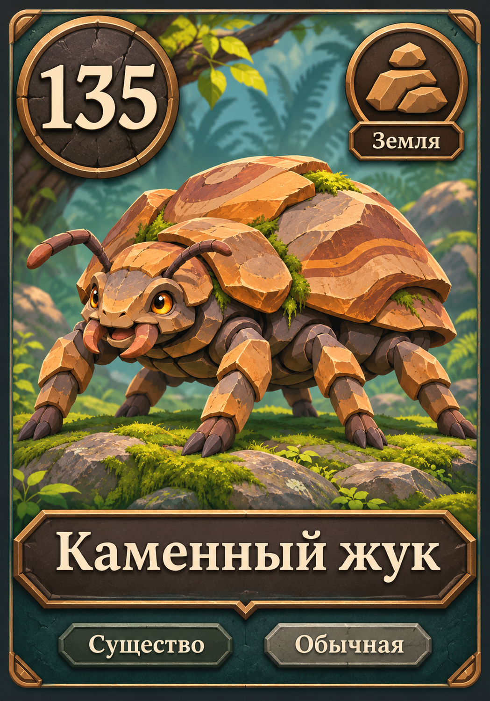

# Стиль артов карт

## Утверждённый макет карты существа

Автор выбрал вариант №2 полной карты: крупный арт с тонкой тёмно-бирюзовой рамкой и бронзовыми деталями.



- Сила — крупный круглый значок в верхнем левом углу.
- Стихия — значок в верхнем правом углу, подпись непосредственно под ним.
- Название — контрастная широкая плашка снизу, под основной частью арта.
- Тип и редкость — компактно под названием.
- Арт занимает большую часть карты; лицо персонажа и важные детали не должны перекрываться значками.
- Это визуальный эталон для переноса в Unity, а не готовая текстура лица карты. Название, сила, стихия и редкость должны выводиться отдельными элементами из данных; сила должна сохранять возможность анимации в битве.
- Для длинных названий предусмотреть перенос или уменьшение шрифта в пределах плашки.
- Для существ с эффектами потребуется адаптация макета с местом для описания: у «Каменного жука» эффект отсутствует.

Макет создан встроенным imagegen на основе утверждённого арта. Исходная иллюстрация жука остаётся отдельным ассетом.

Промпт утверждённого макета:

```text
Use case: ui-mockup / stylized-concept. Create ONE finished high-fidelity FRONT FACE design concept for a creature card in an original fantasy card game. Use the supplied Stone Beetle illustration as the actual artwork, preserving its friendly stylized animated-fantasy appearance, sandstone plates, amber eyes and moss. This is a card FRAME AND INFORMATION LAYOUT exploration, not a new creature illustration. Same subject and image across all design variants. Portrait card, width to height approximately 0.70, fully visible straight-on and flat, no tilted perspective, no hand holding it, no tabletop scene, no other cards. Card occupies almost the entire portrait image with a narrow plain neutral dark backdrop margin. Thoughtful professional game UI art direction: refined tactile materials, controlled ornament, polished bevels with clean readable silhouettes. Suitable for PC and mobile, strong hierarchy: art, title, huge power number, unmistakable Earth icon. Keep UI legible at thumbnail size. Warm fantasy style matching the reference. Common rarity should look restrained, no extravagant legendary gold or jewels. Only the following textual data, reproduced accurately in Russian: title "Каменный жук", power "135", element "Земля", rarity "Обычная", type "Существо". The creature has NO rules ability, so no invented rules paragraph. No mana/health/attack/defense counters or extra numbers, no logo, no watermark, no English. Earth symbol must be an ORIGINAL simple angular stacked-stones or rock icon, not a leaf. Illustrate sensible production-ready areas for live title/power/element text; do not put letters over visually busy art. Use the reference image intact in the art window where possible; modest crop allowed but preserve the face and dominant shell. VARIANT 2 — ART FIRST. A clean contemporary fantasy card with a very thin dark teal stone-and-bronze perimeter frame, almost full-card artwork, simplified restrained corners. Power "135" in a BIG high-contrast circular stone badge in the TOP LEFT. Earth rock emblem in a matching small badge in the TOP RIGHT, with "Земля" beneath the icon on a discrete tiny plate. Give both upper badges generous readable outlines. Title "Каменный жук" on a broad opaque DARK plaque near the BOTTOM with light large lettering. Tiny "Существо" and "Обычная" labels below the title. Art and character dominate; minimize frame texture behind typography. No rules box.
```
Автор выбрал вариант №2 «Каменного жука»: яркое стилизованное мультяшное фэнтези.

Эталон: `Assets/Art/Cards/Creatures/creature.stone-beetle-v1.png`. Арт назначен в поле `_art` карты `creature.stone-beetle`; рамка и игровые надписи формируются Unity.

## Ориентиры

- Крупные, ясные формы и выразительный силуэт, узнаваемый в маленьком размере.
- Стилизованные материалы: несколько крупных каменных пластин вместо мелкого визуального шума.
- Живые, привлекательные персонажи; выражение и пропорции определяются характером существа.
- Живописная двухмерная иллюстрация с чистыми тенями и мягкими бликами.
- Цвета стихии читаются в персонаже; фон проще и слабее по контрасту.
- Персонаж занимает большую часть кадра. Важные детали не прижимать к краям, учитывать обрезку в окне арта.
- В арте нет названий, чисел силы, рамок и значков интерфейса.
- Для следующих артов прикладывать эталон №2 как референс стиля, но не копировать анатомию жука другим существам.

## Генерация эталона

Создан встроенным генератором изображений (imagegen). Конкретный API ID модели инструментом не задавался. Исходный файл сохранён без изменений, импортирован в Unity как Sprite; отклонённые варианты не импортированы.

Использованный промпт:

```text
Use case: stylized-concept. Asset type: standalone illustration for the artwork window of an original fantasy collectible card game. Subject: 'Stone Beetle', an Earth-element common creature. One sturdy six-legged beetle, recognizable insect anatomy, chunky layered sandstone shell like natural rock plates, modest beetle mandibles, small amber eyes, a few tufts of moss in its armor joints. Original creature, no franchise references. Scene: a mossy rocky woodland floor, muted distant fern silhouettes. Composition: a clean readable three-quarter view of the entire beetle, facing slightly left, character occupying about 70% of the image, all six legs clearly attached, simple background with strong subject separation, coherent perspective. Earthy ochre, slate, moss green, restrained amber accents. Match this exact subject, scene and framing across the intended style exploration. No card border, no UI, no letters, no numbers, no caption, no watermark. STYLE B: colorful stylized animated fantasy game illustration, appealing chunky rounded proportions, crisp confident shapes, clean cel-painted shading, expressive friendly beetle face, broad soft highlights. Cheerful adventurous mood, rich but controlled colors, beautifully designed large rock plates; high clarity and readable silhouette. 2D painted animation key art, not a plastic 3D render.
```
