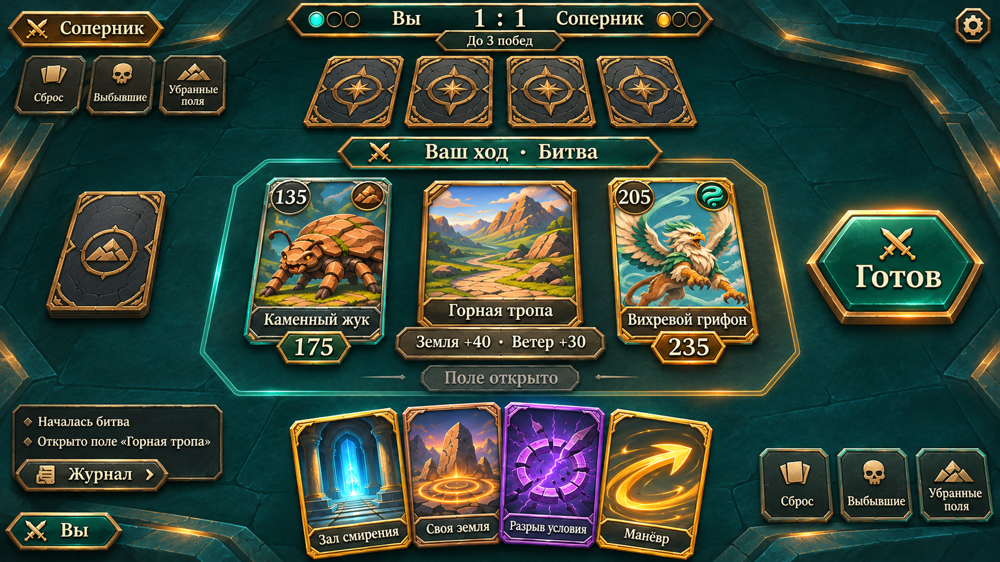
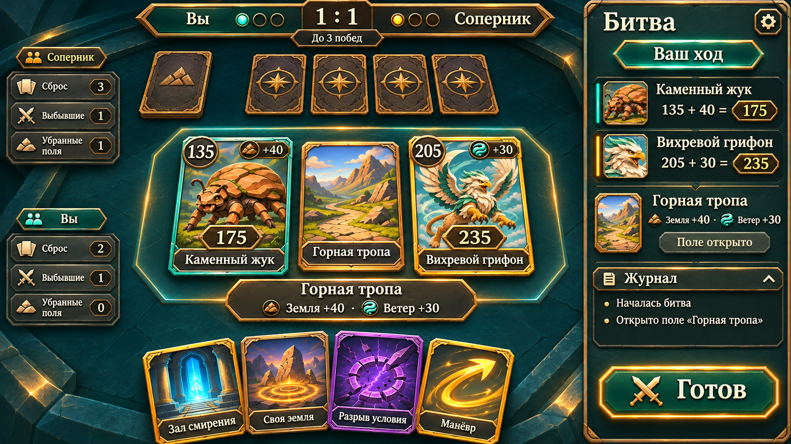
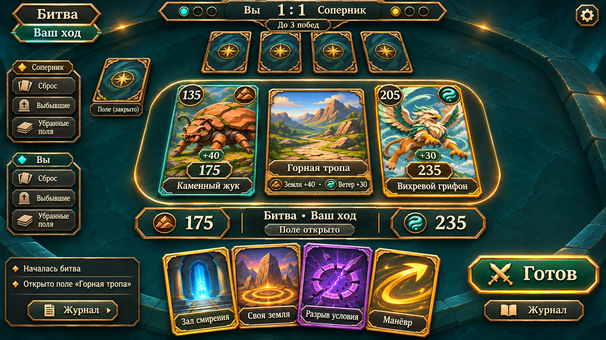

# Варианты интерфейса битвы

Три растровых концепта для выбора направления. Это предложения по расположению элементов, без изменений сцены Unity, кода и правил. Источники структуры: TableLayout, ActionBarView, TopBarView, EventLogView и §4–6 правил.

Общий стиль продолжает меню и коллекцию: бирюзовый камень, бронза, светлый текст, существующие лица существ. Декоративной листвы нет. Иллюстрации полей и способностей на макетах концептуальные, готовыми игровыми ресурсами не являются.

| Вариант | Композиция | Преимущество | Компромисс |
|---|---|---|---|
| 1. Свободный стол | Почти весь экран занимает стол; короткий HUD, «Готов» справа, журнал свёрнут | Больше места картам и перетаскиванию | Разбор бонусов требует раскрытия подробностей |
| 2. Тактическая панель | Стол слева; сила, поле, журнал и действия в правой панели | Причины текущей силы и последние события видны вместе | Панель уменьшает полезную ширину стола |
| 3. Фокус на битве | Крупный активный бой, компактное сравнение силы под ним, рука снизу | Лучше выделяется текущее противостояние | Нужен переход между обычным столом и фокусом битвы |

## Одинаковый пример состояния

Счёт 1:1, партия до трёх побед, ваш ход в битве. «Каменный жук» (135, Земля) и «Вихревой грифон» (205, Ветер) участвуют в битве на одном открытом поле «Горная тропа». Его бонусы дают текущие значения 175 и 235. Второе активное поле соперника закрыто и не участвует в этой битве. Рука соперника скрыта; своя рука открыта. Декоративные стопки и их счётчики на рисунках — схема расположения, не проверенное воспроизведение партии движка.

На открытом поле действие «Открыть поле» уже недоступно; на макетах предложено показывать состояние «Поле открыто». «Готов» относится к битве, «Конец хода» — к основному ходу. «Отмена» появляется при выборе/наведении действия на цель. При реализации доступность берётся из текущих команд движка; никакие кнопки не обходят правила. Доступ к карточным подробностям должен работать нажатием/долгим нажатием, не только наведением. Журнал доступен во всех вариантах, содержимое закрытых полей и чужой руки не раскрывается. Режим показа обеих рук остаётся отладочным, не частью обычного HUD.

Возможный следующий шаг после выбора: уточнить один вариант в двух состояниях — основное действие с выкладкой поля и текущая битва, затем перенести одобренную компоновку в Unity с проверкой 16:9 и 21:9, safe area и зон ввода.

## 1. Свободный стол

## 2. Тактическая панель

## 3. Фокус на битве

Изображения созданы встроенным image_gen, [полные запросы и референсы](mockups/battle-v1/prompts.json). Типографика, иконки и мелкие числа в растровых концептах служат визуальным ориентиром; при реализации они будут отдельными элементами, связанными с данными партии.
