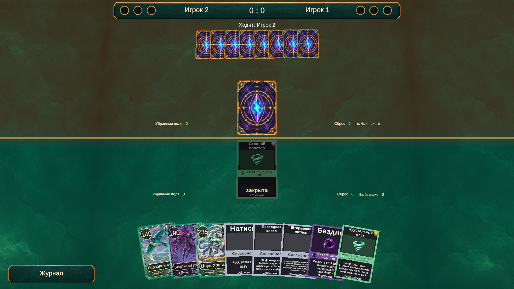

# Рубашка «Астральный кристалл»

Выбран вариант 2: голубой/фиолетовый кристалл, золотая рамка и тёмный фон. Встроенным image_gen подготовлено изображение без внешнего фона. Старый Assets/Art/Icons/card-back.png сохранён.

Рабочая текстура: Assets/Art/Cards/Backs/astral-crystal-clean-v1.png. Отдельный нативный Sprite-ассет astral-crystal-v1.asset задаёт область изображения без нижнего поля (верхние 95% текстуры). Это позволяет сохранить исходные пиксели и не устанавливать отсутствующий пакет 2D Sprite Editor. PNG импортирован через Unity MCP: исходные пропорции, Clamp, Bilinear, mipmaps, максимальный размер 2048, качественное сжатие, обработка прозрачных краёв. Спрайт создан и сохранён средствами Unity; .meta вручную не редактировались.

В VisualSettings.asset поле Card Back Art ссылается на новый спрайт, Card Back установлен в белый, чтобы старый фиолетовый оттенок не затемнял иллюстрацию. Общая рубашка применяется к скрытой руке и закрытым полям. Скрипты и правила не менялись.

В Play mode проверены рука соперника и закрытое поле, а также ссылка на новую текстуру у всех 18 карт. Консоль без ошибок и предупреждений. Пользовательская коллекция не изменялась, Play mode остановлен, runInBackground восстановлен.

Проверить вручную: начать новую партию, посмотреть руку соперника и его закрытое поле, открыть поле и убедиться в корректной смене стороны карты.

## Промпт выбранного варианта (встроенный image_gen)

Use case: stylized-concept. Asset type: fantasy digital card game CARD BACK design proposal. Create ONE single complete portrait card back, front-facing orthographic, 7:10 card proportions centered and almost filling a portrait image, tiny neutral charcoal margin outside the card only. A finished painted game texture with crisp stylized beveled antique bronze-gold rim, neatly clipped corners, subtle hand-painted wear, teal stone/enamel, warm metallic highlights. High quality illustrated fantasy, graphic readable shapes at small screen size, restrained decorative detail. All card design including its lighting and ornamental structure must be perfectly 180-degree rotationally symmetric: identical top and bottom, no readable up direction. No text, letters, numbers, logo, title, leaf ornaments, foliage, creatures, hands, table scene, perspective, or cards stacked together. Full opaque artwork. Same outer card border family for all proposals; original art, not a copy of any commercial game. Proposal 2: ASTRAL CRYSTAL. Deep midnight indigo and muted violet stone ground. A very bold central elongated double-ended diamond crystal glowing icy turquoise and violet, exactly symmetrical top-bottom, suspended inside a slim golden orbital lozenge. Two matching concentric angular rings, restrained gold star-point inlays and subtle arcane geometric grid extending to matching corner ornaments. More dramatic luminous contrast, mysterious magical energy, iconic and easy to recognize even in opponent's small hand. Strong central graphic, ample quiet dark space around it. No conventional compass directions or readable runes.

## Подготовка текстуры

Prepare this EXACT approved card back as a clean game texture. Edit target is the supplied image: purple/blue double-ended glowing astral crystal with gold frame. Preserve the approved illustration, central symbol, colors, ornament, border, and tiny details as closely as possible; do NOT redesign or add anything. ONLY remove the external charcoal studio backdrop and drop shadow outside the actual gold card perimeter. Tightly crop the canvas to the outer card border with zero padding and no extra room below. Keep the whole gold frame intact, front-facing, single portrait card back. Transparent outside the clipped corners; fully opaque inside the card, no holes in the artwork. Portrait 7:10 card texture, gold frame extending all the way to canvas edges. No labels or text.
