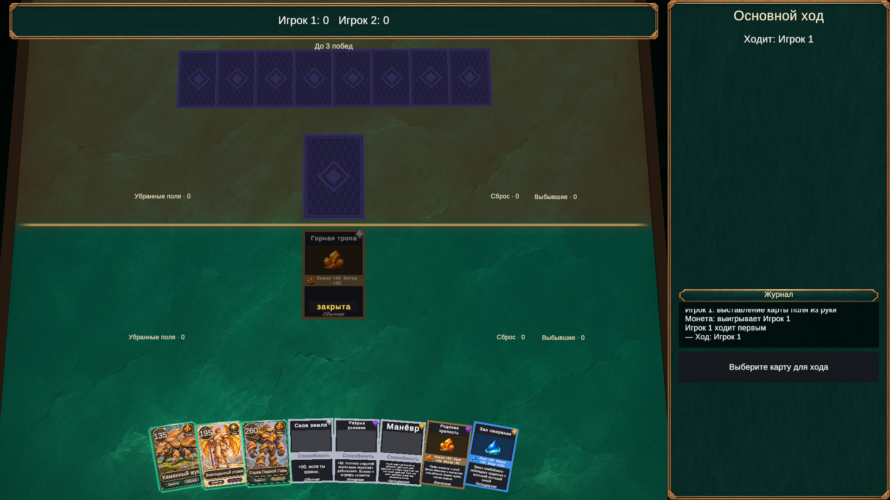
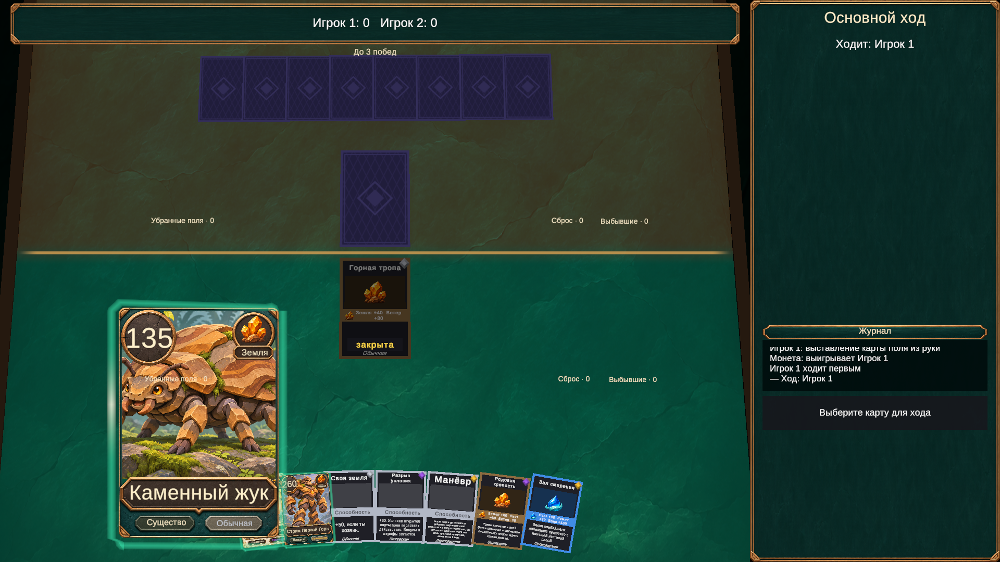

# Подсветка, веер руки и стороны стола

## Изменения

- Широкая непрозрачная зелёная подложка доступных карт заменена отдельным мягким контуром со скошенными углами, пульсацией прозрачности и движущимся светлым бликом. Цвет доступности — бирюзово-зелёный, выбор остаётся золотым, цель — голубой. Источник допустимости прежний: TableInteraction/ActionSelector и команды движка.
- CardPlayableGlow создаёт один LineRenderer на карту и переиспользует его. Эффект расположен под Visual, поэтому следует за подъёмом/перетаскиванием и не изменяет Transform карты, коллайдер или Tween перемещения. Старые renderers подсветки отключены при наличии нового настроенного эффекта. При снятии доступности компонент и renderer выключаются.
- Материал общий, настройки цвета/времени передаются через MaterialPropertyBlock. Время эффекта обновляется по Time.unscaledTime; глобальная скорость игровых анимаций его не ускоряет. Это постоянно работающий индикатор доступности, не эффект события. Частицы, bloom и постобработка не нужны.
- Углы карт в веере развёрнуты: внешние края направлены вниз. Центры крайних карт также опускаются в плоскости руки. HandEdgeDrop в TablePresentation.asset управляет изгибом; запас кадрирования снизу увеличен, чтобы края не обрезались.
- TableSides — одна прозрачная поверхность поверх стола без Collider. Ближняя сторона тонирована бирюзовым, дальняя — приглушённой бронзой; по центру проходит тонкая линия. Геометрия игровых слотов и правила не меняются. В hot-seat нижняя половина относится к текущему зрителю, как и рука/раскладка карт.

## Ресурсы

CardHighlight.asset содержит материал, ширину, отступ контура и периоды пульсации/блика. VisualSettings.asset ссылается на него. CardEdgeGlow.shader — простой прозрачный URP unlit-проход; CardEdgeGlow.mat переиспользуется всеми картами. После первого визуального прохода ширина уточнена с 0.055 до 0.075 для читаемости у игровой камеры.

TableSides.shader, TableSides.mat и TableSidesMesh.asset описывают разделение поверхности; объект TableSides сохранён в Match.unity. Оттенки и толщина центральной линии доступны в материале. Пакеты и исходные арты не менялись. Существующие игровые звуки сохранены, звук для постоянно пульсирующего индикатора не добавлялся.

## Проверка

268/268 EditMode-тестов. Новые проверки: углы и центры краёв веера направлены вниз для пяти и девяти карт; переключение эффекта десять раз не создаёт дополнительные LineRenderer и коллайдеры, выключает renderer и использует поддерживаемый шейдер.

Play mode через MCP: постоянные 18 компонентов эффекта на картах, активны только три доступных существа; часы материала менялись между выборками (152.79, 196.88, 243.02, 352.44 секунды), старая непрозрачная подсветка выключена. Проверены обычный вид и подъём карты. Выбор карты, отмена и drag/drop на поле прошли через PointerInput и TableRaycaster; сыгранная карта перестала подсвечиваться. Поверхность разделения не имеет Collider. Проверена сохранность руки в границах камеры на 1920×1080, 1280×720 и 2100×900.

Консоль без ошибок и предупреждений. Временная коллекция была в памяти; сохранённые колоды не менялись. Play mode, runInBackground и Game View возвращены к исходному состоянию, временный ключ проверки удалён.

## Визуальная оценка затронутой сцены

Palette discipline: 4/5 — бирюза и бронза продолжают утверждённый стиль; исходно 3/5 из-за яркой подложки.
Style uniformity: 3/5 — арты существ и интерфейс согласованы, прежние заглушки полей/способностей остались.
Lighting depth: 3/5 — существующий свет не менялся, новый эффект не требует bloom.
Silhouette: 4/5 — контур не заливает изображение карты, арт читается при подъёме.
UI intentionality: 4/5 — дуга руки и граница двух сторон различимы, ввод сохранён.
Feedback visibility: 4/5 — вместо исходной статической подложки (2/5) видны пульсация и бегущий блик; движение подтверждено часами материала.

Применён навык craft-game-floors: прочитаны references/vfx.md, references/game-feel.md и references/visual-scorecard.md. Использована существующая палитра меню/коллекции; это проверка затронутой сцены, не аудит всей игры. Технические справочники Unity 6000.6: [LineRenderer](https://docs.unity3d.com/6000.6/Documentation/Manual/class-LineRenderer.html), [прозрачное смешивание](https://docs.unity3d.com/6000.6/Documentation/Manual/SL-Blend.html), [Time.unscaledTime](https://docs.unity3d.com/6000.6/Documentation/ScriptReference/Time-unscaledTime.html).

