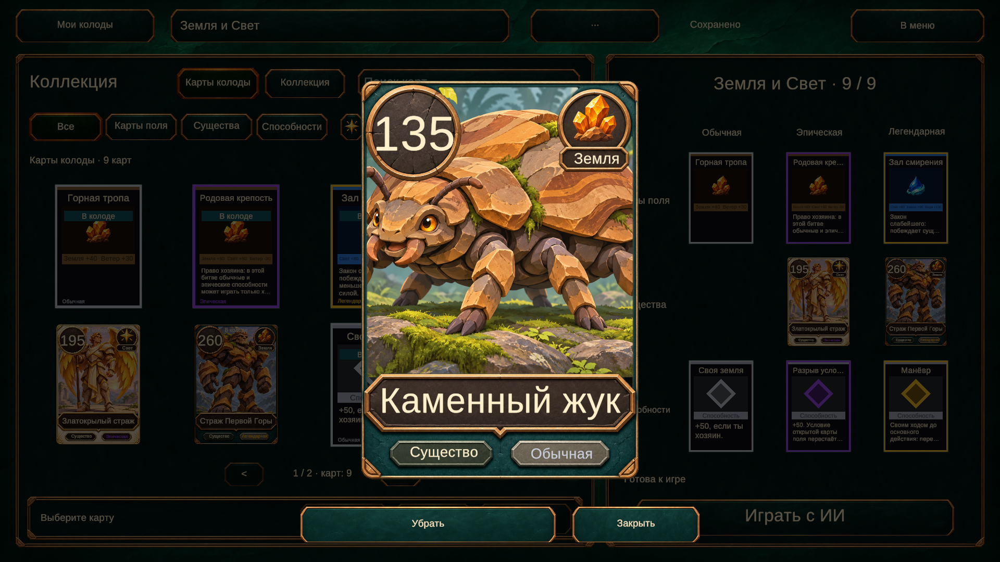

# Анимированный просмотр карты в коллекции

Нажатие на карту в центральной сетке или заполненной ячейке колоды открывает крупную карту в центре экрана. Она вылетает из нажатого экземпляра, фон затемняется, исходный экземпляр скрывается. Закрытие по карте, фону или кнопке возвращает карту на прежнее место и обновляет выделение в редакторе.

Под картой доступна кнопка добавления/замены либо удаления из колоды. Просмотр не меняет колоду сам по себе. Пустые ячейки сохраняют подбор по типу и редкости. Нижние действия редактора и кнопка подробностей используют тот же выбор карты.

Используется существующий CollectionCardView, включая общий шаблон существ. Шрифт правил крупного просмотра подстраивается так, чтобы текст помещался. DOTween работает по реальному времени; повторное открытие, навигация и уничтожение экрана отменяют старую анимацию. Никаких новых пакетов или правил игры.

Размер и длительности настраиваются в Assets/Data/Config/Collection.asset: Preview Height 0,82 высоты безопасной области, Preview Open Seconds 0,22, Preview Close Seconds 0,18. Расчёт выполняется в локальных координатах модального слоя и учитывает масштаб Canvas. CollectionDeckGrid передаёт координаты именно нажатой ячейки, даже если та же карта одновременно видна в центре.

## Проверка

Через Unity MCP в Play mode проверены 1920×1080 и 1280×720: крупная карта по центру, не обрезается; исходная карта скрывается. Проверены открытие из центральной сетки и правой ячейки, поле и существо, полный текст условий, закрытие по фону и кнопке, четыре быстрых повторных открытия, удаление и повторное добавление, подбор после нажатия пустой ячейки. Действия выполнялись на MemoryCollectionStore; пользовательские пресеты и PlayerPrefs не редактировались.

Консоль чистая, Play mode остановлен, исходный Game View и runInBackground восстановлены.

Все 277 EditMode-тестов прошли через Unity MCP.

Проверить вручную: Коллекция → нажать на карту → закрыть нажатием фона; затем открыть карту в правой колоде, удалить её и заполнить освободившуюся ячейку.
