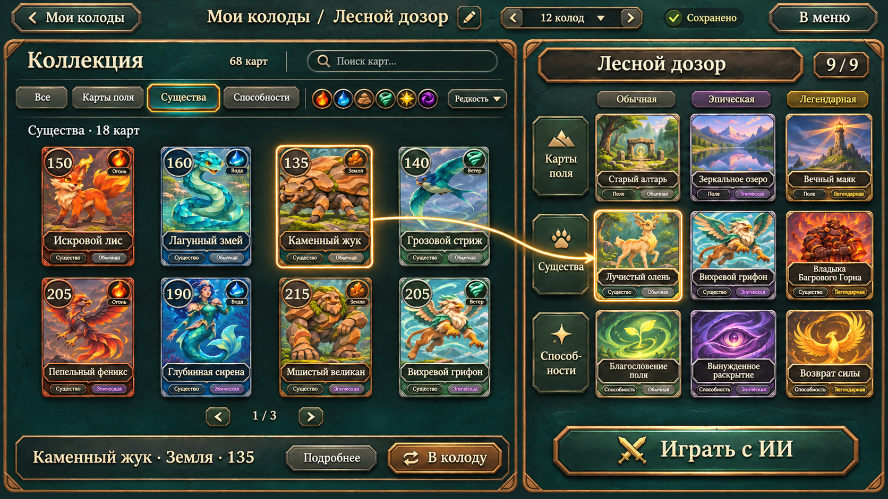
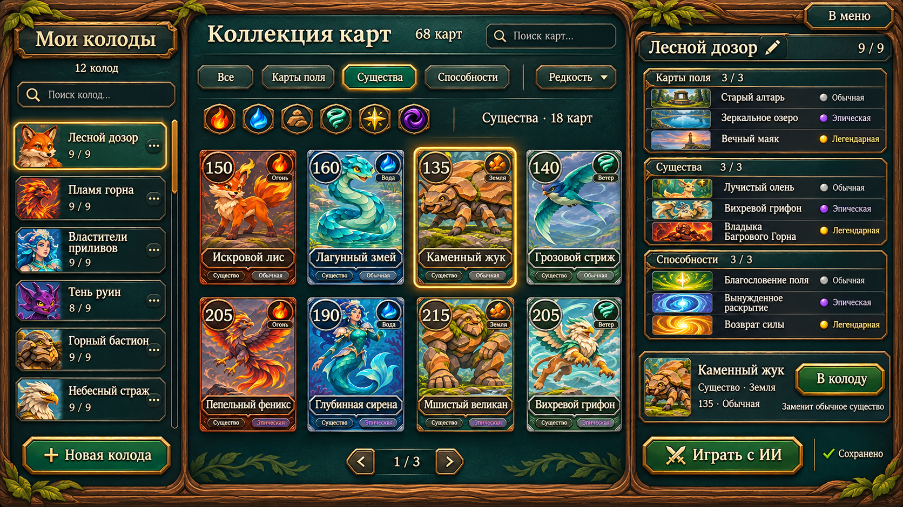
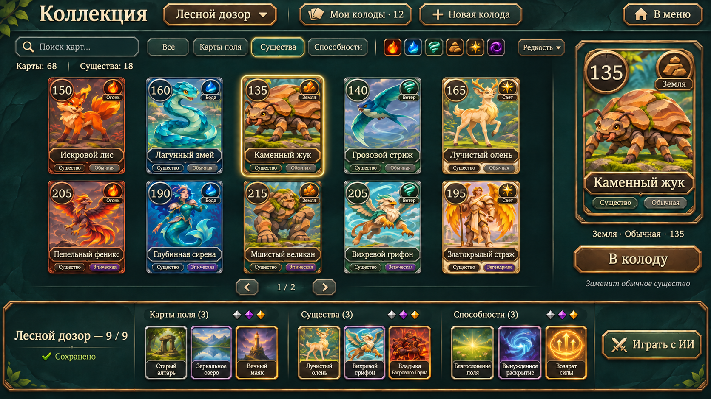
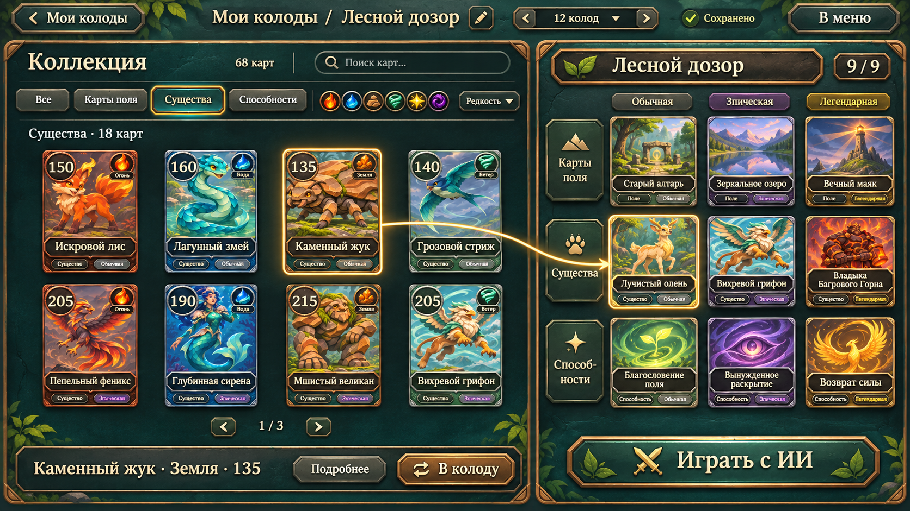
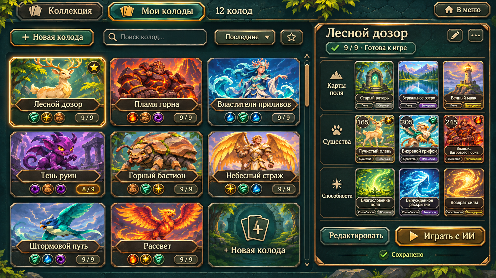

# Варианты оформления коллекции

## Выбранное направление и уточнение

Автор выбрал вариант 3 «Библиотека — редактор». Декоративная листва убрана с фона, рамок, заголовка колоды и кнопок. Растительность внутри иллюстраций карт сохранена. Актуальный макет:

Направление реализовано в Unity: [описание и скриншоты](collection-library.md). Ниже сохранены макеты как визуальные ориентиры.

Изменение выполнено встроенным image_gen. Запрос и исходный референс сохранены в [mockups/collection-v2/prompts.json](mockups/collection-v2/prompts.json). Ниже сохранены первоначальные варианты для сравнения.

Три направления для выбора автором. Это растровые дизайн-макеты, созданные встроенным image_gen. Изменения игрового интерфейса, правил и ограничения числа пресетов ещё не выполнялись. Для проверки масштабирования на макетах условно показаны 12 колод; это пример, а не новый лимит.

Общая стилистика: утверждённые арты существ, тёмно-бирюзовый камень, бронза, светлые надписи, простые хорошо различимые состояния. Макеты используют визуальные концепты артов поля и способностей только для примера; готовые игровые спрайты этих типов этим шагом не создаются.

| Направление | Расположение | Управление множеством колод | Компромисс |
|---|---|---|---|
| 1. Мастерская | Слева колоды, в центре коллекция, справа состав и выбранная карта | Поиск и прокрутка списка | Всё доступно одновременно, но больше панелей |
| 2. Галерея | Основная область — крупные карты, справа просмотр, снизу девять карт колоды | Компактный переключатель и открываемый список | Больше места артам; управление колодами требует открытия списка |
| 3. Библиотека | Отдельный каталог колод; редактор с коллекцией слева и составом 3×3 справа | Плитки обложек, поиск, сортировка и прокрутка | Лучше для большого числа колод; дополнительный переход между каталогом и редактором |

Рекомендация для дальнейшей проработки: вариант 3, поскольку матрица девяти слотов явно показывает ограничения нашей колоды; вариант 2 — если приоритетом станет крупный просмотр артов.

## 1. Мастерская

## 2. Галерея

## 3. Библиотека: редактор

## 3. Библиотека: выбор колоды

## Что учтено

- Колода состоит из девяти карт: по три поля, существа и способности, по одной каждой редкости. Подбор карты заменяет соответствующий слот.
- Три закреплённые вкладки пресетов заменяются списком, переключателем или каталогом, рассчитанным на рост.
- Во всех вариантах нужны поиск колод, создание новой, переименование и контекстные действия. Удаление по прежней договорённости оставляет пустую ячейку, доступную для заполнения; её оформление соответствует «+ Новая колода».
- Фильтры типов остаются явными кнопками. Поиск карт, фильтры стихий/редкости, избранные колоды и сортировка — предложенные функции для будущей реализации.
- Названия, счётчики, тексты и состояния при переносе в Unity должны быть живыми элементами. Изображения макетов не являются готовой фоновой текстурой с запечёнными надписями.
- Крупный просмотр должен открываться нажатием или долгим нажатием. Переименование и контекстные действия доступны без наведения мыши.
- Для переноса на узкие экраны потребуется адаптация сетки и открываемые боковые панели; макеты показывают широкоформатный ПК.
- Текущий PlayerCollection.PresetCount и хранение фиксированных трёх пресетов потребуют отдельного изменения с сохранением существующих колод, когда направление будет выбрано.

## Исследованные примеры

Использовались идеи организации и взаимодействия, а не оформление или персонажи других игр. Старые материалы служат примерами решений своего времени; их числа слотов не считаются актуальными лимитами.

- Hearthstone: коллекция, отдельный список колод и разделение карточного просмотра и состава. [Collection manager](https://hearthstone.wiki.gg/wiki/Collection_manager); [официальный материал о расширении слотов в 2016 году](https://news.blizzard.com/en-us/article/19995505/a-new-way-to-play).
- Yu-Gi-Oh! Master Duel: отдельный выбор колоды, редактор с областями коллекции, состава и выбранной карты. [Иллюстрированное руководство](https://outof.games/realms/yugioh/guides/138-how-to-use-yu-gi-oh-master-duels-deckbuilder-to-create-decks/).
- Pokémon TCG Live: фильтры, выделение выбранной карты, полный просмотр состава и объяснение недопустимой колоды. [Официальный обзор редактора](https://community.pokemon.com/en-us/discussion/24855/get-acquainted-with-the-enhanced-deck-editor-experience-in-pokemon-tcg-live).
- MTG Arena: каталог колод, избранное и сортировка по последней игре. [Официальный обзор с изображениями](https://magic.wizards.com/en/news/feature/mtg-arena-state-game-january-2020-01-10); [текущая страница начала игры](https://magic.wizards.com/en/mtgarena/getting-started).

## Генерация

Все исходные запросы, референсы и уточнение второго макета: [mockups/collection-v1/prompts.json](mockups/collection-v1/prompts.json). Инструмент — встроенный image_gen, фон непрозрачный. Результаты просмотрены: четыре изображения представляют три компоновки, третья — в двух состояниях. Выбрано третье направление; его актуальное уточнение без листвы приведено в начале документа.
