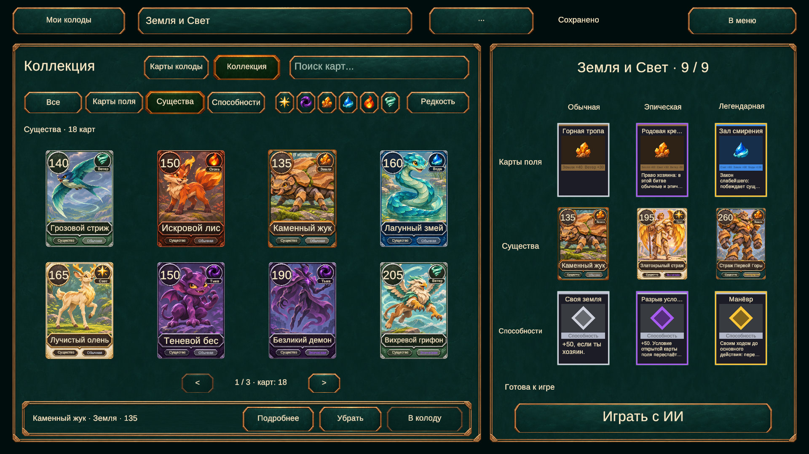
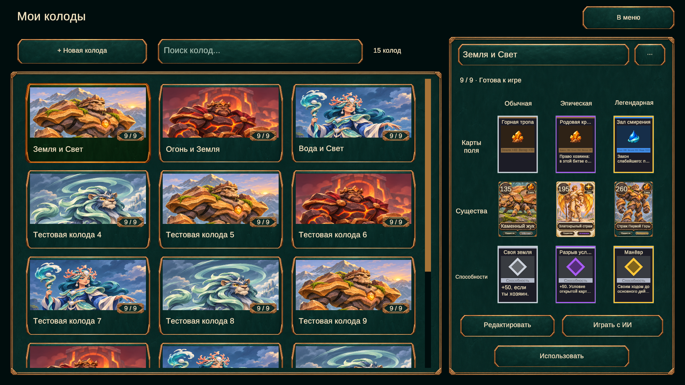

# Библиотека колод и редактор
Выбранный вариант «Библиотека — редактор» реализован в uGUI. Экран использует отдельные PNG панелей и кнопок без декоративной растительности, живой текст и существующие лица карт.

## Работа экрана
- Коллекция открывает редактор выбранного пресета. Слева — восемь карт на странице; справа — матрица 3×3: типы по строкам, редкости по столбцам.
- «Карты колоды» показывает состав пресета, «Коллекция» — доступные карты. Работают поиск по имени/описанию, кнопки типов, переключаемые стихии и циклический фильтр редкости.
- Нажатие на ячейку состава показывает подходящие карты этого типа и редкости. Выбранная карта подсвечивается; «В колоду» заменяет соответствующую ячейку, «Убрать» освобождает её.
- «Подробнее» открывает крупную карту и описание. Действия доступны нажатием, без зависимости от наведения.
- «Мои колоды» открывает библиотеку с обложками, поиском и вертикальной прокруткой. Нажатие выбирает плитку; «Редактировать», «Использовать» и «Играть с ИИ» работают с выбранным пресетом.
- «+ Новая колода» добавляет пустой именованный пресет. Число пресетов больше не ограничено тремя; на первом запуске остаются прежние три стартовые колоды.
- Название редактируется в поле и сохраняется при завершении ввода. «...» открывает действие «Очистить колоду»; ячейка и владение картами сохраняются.
- Запуск заблокирован для неполного/недопустимого состава. Именные способности проверяются прежним DeckValidator.

## Сохранения
PlayerCollection теперь хранит список и свойство Count. Старые ключи collection.v1.deck.N.name/cards и collection.v1.selected сохранены. Добавлен collection.v1.count. При отсутствии нового ключа загружаются исходные три слота, включая пустые и безымянные; их содержимое не переписывается загрузкой. Новые слоты дописываются, очистка не сдвигает индексы.

## Графика и настройки
- Assets/Art/UI/Collection/panel-v1.png — рамка панели с тёмно-бирюзовым камнем.
- Assets/Art/UI/Collection/button-v1.png — фон кнопки с бронзовой окантовкой.
- Assets/Data/Config/Collection.asset — ссылки на графику, нормализованные области спрайтов, плотность рамок, цвета и шрифт.
- CollectionUi создаёт два кешированных runtime-спрайта для девятисегментного растяжения, используя заданные области исходных текстур. PNG и метаданные прямоугольников исходников не редактируются; спрайты освобождаются вместе с экраном.
- Источники получены встроенным image_gen по утверждённому макету. Полные запросы: [art-prompts/collection-ui-v1.json](art-prompts/collection-ui-v1.json).
- Декоративная растительность отсутствует; лес внутри артов карт сохранён. Поля и способности пока используют прежние лица и заглушки арта; новая графика интерфейса не подменяет данные этих карт.

## Проверка
265/265 EditMode-тестов через MCP. Добавлены проверки загрузки старых трёх слотов, роста до 15, сохранения выбора дополнительной колоды, очистки с сохранением ячейки и восстановления после некорректного счётчика.

Play mode на временном хранилище в памяти: 15 колод с прокруткой; поиск, фильтры, страницы, переименование, замена, подробный просмотр, удаление карты и блокировка неполной колоды. Через UI создан и собран шестнадцатый пресет; очистка сохранила его пустую ячейку, другие колоды не изменились. Матч против ИИ запущен с 15-м пресетом: все девять ID совпали с отредактированным составом, ИИ подключён. Пользовательские PlayerPrefs при проверке не изменялись.

Визуально проверены 1920×1080, 1280×720 и 2100×900 (21:9), наследование SafeAreaFitter, EventSystem и GraphicRaycaster. Временные разрешения удалены, исходный Game View восстановлен. После проверки консоль без ошибок и предупреждений, Play mode остановлен.

## Скриншоты

## Проверить вручную
1. Bootstrap → коллекция: выбрать пресет, открыть все три типа карт, поиск, стихию и редкость.
2. Нажать ячейку состава, выбрать замену, добавить и убрать карту; открыть «Подробнее».
3. Перейти в «Мои колоды», создать четвёртую колоду, переименовать, заполнить девять слотов.
4. Перезапустить приложение и проверить сохранение; очистить колоду через «...» и убедиться, что ячейка осталась.
5. Выбрать допустимый состав и запустить ИИ; неполный состав должен блокировать запуск.
