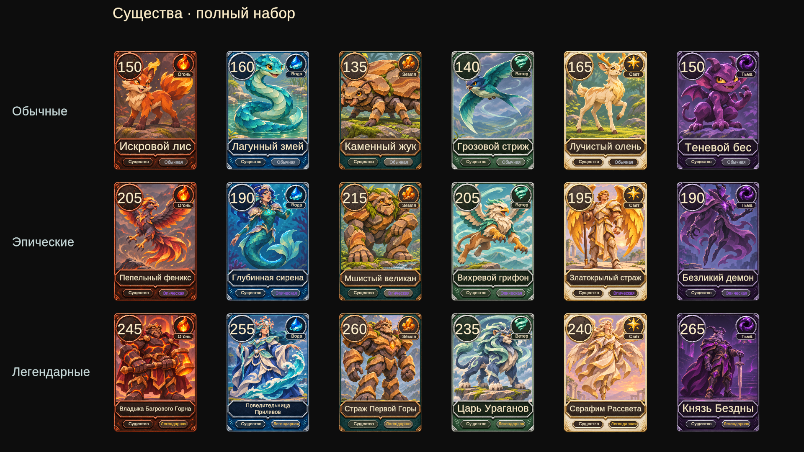

# Арты существ — первый набор

Все 18 существ получили отдельные иллюстрации: по шесть обычных, эпических и легендарных. Каменный жук — ранее утверждённый эталон; остальные 17 артов созданы встроенным image_gen с ним в качестве референса стиля.

Новые иллюстрации — портретные PNG с фоном, без встроенных надписей, рамок и счётчиков. Сила, названия, стихии и редкость отображаются общим шаблоном Unity. Изображения назначены только в поле CardDef._art соответствующих существ.

| Карта | Стихия | Редкость | Ассет |
|---|---|---|---|
| Каменный жук | Земля | Обычная | `Assets/Art/Cards/Creatures/creature.stone-beetle-v1.png` |
| Искровой лис | Огонь | Обычная | `Assets/Art/Cards/Creatures/creature.spark-fox-v1.png` |
| Лагунный змей | Вода | Обычная | `Assets/Art/Cards/Creatures/creature.lagoon-serpent-v1.png` |
| Грозовой стриж | Ветер | Обычная | `Assets/Art/Cards/Creatures/creature.storm-swift-v1.png` |
| Лучистый олень | Свет | Обычная | `Assets/Art/Cards/Creatures/creature.radiant-stag-v1.png` |
| Теневой бес | Тьма | Обычная | `Assets/Art/Cards/Creatures/creature.shadow-imp-v1.png` |
| Пепельный феникс | Огонь | Эпическая | `Assets/Art/Cards/Creatures/creature.ash-phoenix-v1.png` |
| Глубинная сирена | Вода | Эпическая | `Assets/Art/Cards/Creatures/creature.deep-siren-v1.png` |
| Мшистый великан | Земля | Эпическая | `Assets/Art/Cards/Creatures/creature.mossy-giant-v1.png` |
| Вихревой грифон | Ветер | Эпическая | `Assets/Art/Cards/Creatures/creature.whirlwind-griffin-v1.png` |
| Златокрылый страж | Свет | Эпическая | `Assets/Art/Cards/Creatures/creature.goldwing-guardian-v1.png` |
| Безликий демон | Тьма | Эпическая | `Assets/Art/Cards/Creatures/creature.faceless-demon-v1.png` |
| Владыка Багрового Горна | Огонь | Легендарная | `Assets/Art/Cards/Creatures/creature.lord-of-crimson-forge-v1.png` |
| Повелительница Приливов | Вода | Легендарная | `Assets/Art/Cards/Creatures/creature.mistress-of-tides-v1.png` |
| Страж Первой Горы | Земля | Легендарная | `Assets/Art/Cards/Creatures/creature.guardian-of-first-mountain-v1.png` |
| Царь Ураганов | Ветер | Легендарная | `Assets/Art/Cards/Creatures/creature.hurricane-king-v1.png` |
| Серафим Рассвета | Свет | Легендарная | `Assets/Art/Cards/Creatures/creature.dawn-seraph-v1.png` |
| Князь Бездны | Тьма | Легендарная | `Assets/Art/Cards/Creatures/creature.prince-of-abyss-v2.png` |

## Импорт и промпты

Параметры 17 новых PNG: Sprite Single, Full Rect, Bilinear, Clamp, без mipmaps и CPU-readable копии, alpha source None, Max Size 1024, Compressed HQ. Полные исходники сохранены в PNG; ограничение 1024 применяется только при импорте Unity. Эталонный Каменный жук сохранён с прежними настройками.

Полный набор запросов, стабильные ID и пути: [art-prompts/creature-art-v1.json](art-prompts/creature-art-v1.json). Генератор — встроенный image_gen, transparent_background=false, одна генерация на существо. API-модель инструментом не задавалась.

Князь Бездны дополнительно перекомпонован после проверки на карте: увеличен запас над рогами и короной. Версия v2 назначена карте, промежуточный v1 не импортируется в итоговый набор. Запрос редактирования:

```text
Use case: precise-object-edit. Input image 1 is the EDIT TARGET. Preserve this exact regal abyss prince character, facial identity, two curved horns, purple crown, dark amethyst armor, long sword, cloak, painterly style, colors and ruined setting. Fix only the framing for a portrait card artwork window. The current head is too close to the top and the horns are cropped when displayed on the card. Zoom the entire figure out about 18 percent and lower the upper body within the composition. Show BOTH COMPLETE horns, crown and head fully inside the central 60 percent of the canvas width. Put the TOPMOST horn at least 18 percent down from the top edge, eyes about 33 percent down. All of the upper 16 percent should be quiet dim violet architectural background; extend the background naturally. Keep feet and the sword tip inside the image, with a little ground below, figure occupying roughly 75 percent of image height. Maintain a readable strong silhouette at card thumbnail size. Portrait 4:5, complete opaque background. One prince only. No card frame, no UI, no text, no numbers, no watermark. Do not redesign the character or add people.
```

## Проверка

Проверка через MCP: 18/18 CreatureDef имеют разные спрайты, и CardFaceBuilder передаёт каждому нужный арт. Все 262/262 EditMode-теста прошли. В Play mode просмотрены страницы коллекции для всех трёх редкостей, общий предпросмотр 18 карт, карты в руке и крупный просмотр Князя Бездны v2. Консоль Unity: 0 ошибок и предупреждений.

Общий предпросмотр всех карт:



Ручная проверка: Bootstrap → коллекция → слоты существ обычной, эпической и легендарной редкости; на каждой странице шесть карт. Открыть матч и крупный просмотр. Проверить положение лица относительно верхних значков, отсутствие искажений, читаемость названия и силы.
