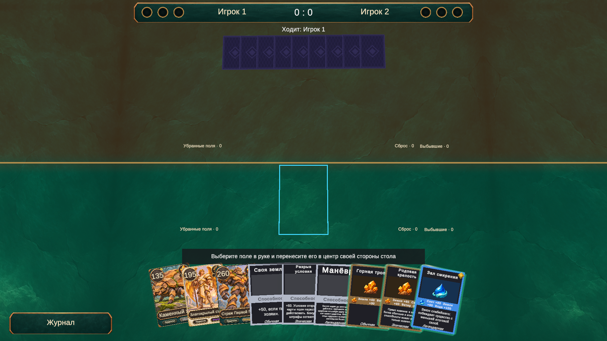

# Нахлёст и размещение рук

Карты руки игрока перекрываются слева направо: правая карта целиком лежит перед левой. Раньше небольшой шаг по мировой Y почти не разделял плоскости по глубине при наклоне камеры 82°, поэтому лицо и подсветка одной карты пересекали слои соседней.

TableLayout раскладывает карты по нормали к их лицу, с шагом Hand Depth Step в TablePresentation.asset (0,08). Правая карта остаётся на исходной глубине, предыдущие уходят дальше. Верхние слои подсветки приближены к поверхности карты (локальная Z −0,015), поэтому непрозрачная рубашка следующей карты скрывает эффект предыдущей. Проверено, что вся рука из 9 карт остаётся над поверхностью стола. Подъём выбранной карты и перетаскивание по-прежнему намеренно выводят её вперёд.

В TacticalHud.asset добавлены Opponent Hand Spacing (0,95 вместо общего шага 1,6) и Opponent Hand Raise (1 мировая единица). Базовая дистанция 5,2 сохранена. Смещение вверх не участвует в расчёте размера обзора камеры: иначе CameraFramer отдаляет камеру и визуально отменяет перемещение руки. Рука соперника учитывает доступную ширину экрана и появляется из зоны над её новым положением.

Через MCP в Play mode проверены 1920×1080, 1280×720 и 2100×900: руки из 1, 7 и 9 карт помещаются в экран и не пересекаются с кнопками; соседние слоты поля разделены. Геометрическая проверка подтверждает, что рубашка правой карты находится перед контуром левой на всём веере. Визуально проверены полная рука, одно направление нахлёста, скрытие контуров соседними картами и верхняя рука. Консоль без ошибок и предупреждений. Game View и runInBackground восстановлены, Play mode остановлен. Пользовательская коллекция не менялась.

268 EditMode-тестов пройдены через Unity MCP.

## Закрытие щели после розыгрыша

TableSync пересчитывает индекс и размер руки после ухода карты. HandFocus теперь повторно применяет фокус и смещения соседей после завершения очереди анимаций. Если поднятая карта покинула руку, смещения плавно снимаются; если в руке остаётся другая выбранная карта, её окружение рассчитывается по новым позициям. Исправлено раннее сравнение двух недействительных ссылок, из-за которого соседи сыгранной карты могли остаться раздвинутыми.

270 EditMode-тестов пройдены, включая два новых случая ухода поднятой карты: с движением мыши и без него. В Play mode партии против ИИ поднята и разыграна карта поля из полной руки: все 8 оставшихся карт заняли новые слоты, локальные смещения снялись без движения указателя. Консоль чистая, Play mode остановлен. Проверить вручную: разыграть карту из середины руки нажатием и перетаскиванием, дождаться анимации; веер должен закрыть щель.

## Возврат существ без старого выбора

HandFocus забывает ссылки наведения и закреплённого выбора, когда карта покидает руку. Раньше ссылка сохранялась, хотя временно считалась недействительной. Когда тот же CardView возвращался из выбывших, старое наведение или выбор снова поднимали его над следующей картой. Теперь возврат восстанавливает обычный нахлёст, а новый жест по-прежнему позволяет поднять вернувшуюся карту.

Добавлены два регрессионных теста: наведение и закреплённый выбор → уход из руки → возврат того же CardView. Проверяются отсутствие самопроизвольного подъёма и смещений соседей, а также возможность нового выбора после возврата. Проверить вручную: выбрать существо, разыграть его, дождаться возврата всех существ; без нового наведения или нажатия карты должны перекрываться слева направо.

Все 272 EditMode-теста пройдены через MCP, консоль чистая.

### Очистка анимаций в EditMode-тестах

Тест возврата существ после последней проверки нового выбора создавал три новых tween и сразу удалял карты. В EditMode обычный OnDestroy карты не выполнял их очистку, поэтому при следующем обновлении DOTween возникало предупреждение об уничтоженном Transform. Источник воспроизведён отдельно: до теста 0 активных tween, после — 3 с уничтоженными целями.

В обоих тестах фокуса добавлена явная отмена анимаций каждой тестовой карты перед DestroyImmediate, без завершения и вызова callback. Добавлена проверка, что число активных tween после теста равно исходному. Повторное выполнение обоих вариантов возврата оставляет 0 активных tween.

Повторно пройдены все 272 теста; после полного прогона активных tween — 0. Последующий вход и выход из Play mode не вызывают предупреждений или ошибок. Play mode остановлен.

## Изменение состава руки

Дополнительно выявлен случай, когда старая выбранная карта оставалась в руке, а рядом возвращались другие существа. Одного удаления ссылок на покинувшие руку карты недостаточно: после изменения состава веера прежний подъём тоже теряет актуальность. HandFocus теперь отслеживает состав руки и снимает прежнее наведение и закрепление при добавлении или удалении карт. Refresh плавно возвращает все визуальные части в слоты. Новое наведение или нажатие по-прежнему поднимает карту.

Регрессионные тесты охватывают наведение и закрепление как для возвращающейся карты, так и для карты, остававшейся в руке. Все 275 EditMode-тестов прошли через MCP; консоль чистая, активных тестовых tween не оставлено.

В интерфейсе скрыта обычная подсказка «Выберите карту для хода». Подсказки выбора поля и цели сохранены. Значок условия поля отключён: отменённое условие отображается перечёркнутым текстом, при восстановлении условия перечёркивание снимается. Это проверено тестом и визуальным предпросмотром отменённой «Бездны» в Play mode; для предпросмотра создана временная копия карты, состояние правил не менялось. Play mode остановлен, Bootstrap и runInBackground восстановлены.

Проверить вручную: дождаться возврата всех существ, оставив указатель неподвижным и ранее выбрав карту, которая остаётся в руке; весь веер должен вернуться к обычному нахлёсту. Затем выбрать любую карту новым жестом. В битве отменить условие поля и проверить перечёркивание без значка «!».

Проверить вручную: в начале партии осмотреть полную руку, выбрать по очереди левую, среднюю и правую карты, отпустить после перетаскивания. Подсветка должна оставаться у своей карты; после снятия выбора должен восстанавливаться нахлёст слева направо.
