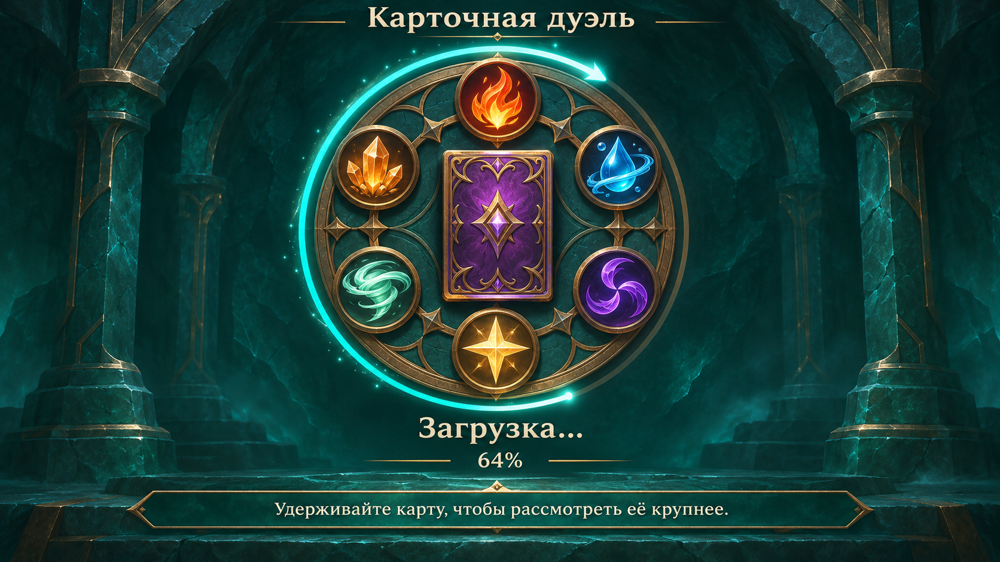
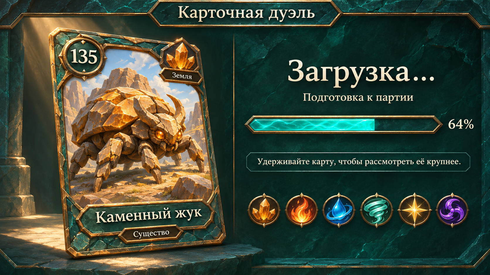
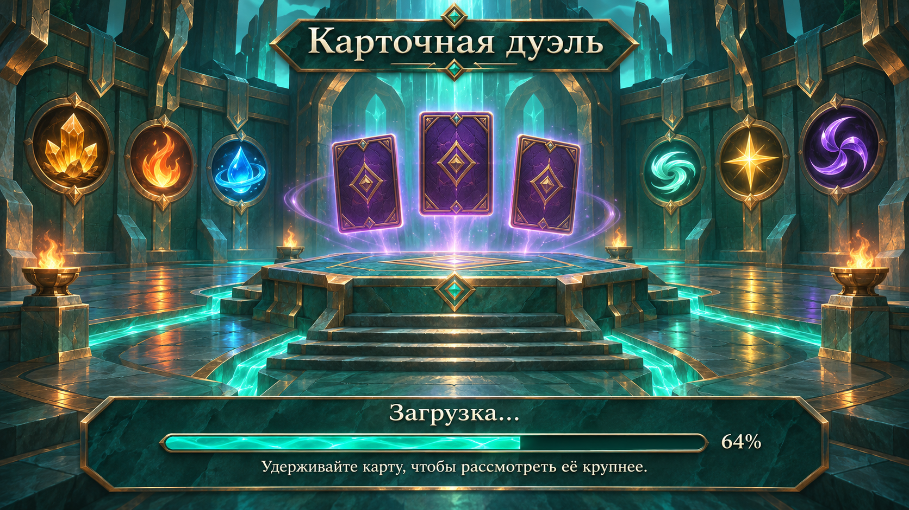

# Макеты экрана загрузки

Три концепта для выбора. Сгенерированы встроенным image_gen; это статические макеты, экран загрузки пока не внедрён в Unity. Все варианты используют бирюзовый камень, бронзовые грани, кремовый текст и шесть стихий, без листвы.

## 1. Круг стихий



## 2. Карта крупным планом



## 3. Арена перед битвой



## Сравнение

| Вариант | Акцент | Возможная анимация при реализации |
|---|---|---|
| 1. Круг стихий | Центральная эмблема и шесть медальонов | Заполнение дуги, мягкое свечение стихий |
| 2. Карта крупным планом | Иллюстрации существ из игры | Плавная смена карты и заполнение полосы |
| 3. Арена перед битвой | Атмосферное окружение | Парящие карты, свет и полоса прогресса |

Проценты 64% на макетах служат примером отображения прогресса. При реализации значение должно отражать загрузку, а не искусственную задержку. Окончательные шрифт, рамки и арты карт следует переиспользовать из проекта.

## Промпты

Использован встроенный инструмент image_gen, без CLI/API fallback. Ниже полный набор промптов для воспроизведения направления.

### 1. Круг стихий

```text
Use case: ui-mockup. Create ONE polished full-screen loading screen concept for an existing Russian fantasy collectible card duel game. Landscape 16:9, designed as a crisp 1920x1080 game screenshot; no surrounding device, no presentation slide or collage. Established visual identity: deep teal green mineral stone, thin warm bronze/gold chamfered metal borders, ivory readable lettering, colorful sculpted elemental jewels, painterly fantasy illustration with clean legible forms and restrained magical glow. Match an ancient teal stone altar UI, not medieval parchment. Six element symbols are amber crystal cluster (earth), orange flame (fire), blue droplet with orbiting water ribbon (water), mint whirlwind (wind), gold four-point star (light), violet three-bladed vortex (darkness). No leaves, vines, foliage or floral decorations anywhere. No competing menu buttons, no ads, no fake app store branding, no logos of other games, no developer information. All visible text must be in Russian with correctly spelled Cyrillic. Keep all functional UI within 6% safe margins and ensure readable contrast. This is an actual usable loading layout, with clear loading feedback and one short tip; do not add gameplay HUDs or VS player portraits.
Concept 1: ELEMENTAL CIRCLE. Symmetrical calm composition, richly textured dark teal stone background with a faint architectural arch in shadow. A large ancient bronze circular seal occupies the central 55% of height. Place the six distinct element medallions evenly around its rim, and a beautifully ornamented purple card back with a simple diamond emblem at its center. A thin luminous turquoise progress arc hugs the outside of the circle and fills about 64% of its circumference; it is a credible animation frame, with a few restrained traveling sparks. Leave plenty of quiet space on each side. At top center write "Карточная дуэль", medium sized. Under the seal write "Загрузка…" and smaller "64%". At the bottom on a discreet translucent teal bronze-trimmed strip write exactly "Удерживайте карту, чтобы рассмотреть её крупнее." Keep the effect sophisticated and uncluttered. Do not write "вариант 1" in the image.
```

### 2. Карта крупным планом

```text
Use case: ui-mockup. Create ONE polished full-screen loading screen concept for an existing Russian fantasy collectible card duel game. Landscape 16:9, designed as a crisp 1920x1080 game screenshot; no surrounding device, no presentation slide or collage. Established visual identity: deep teal green mineral stone, thin warm bronze/gold chamfered metal borders, ivory readable lettering, colorful sculpted elemental jewels, painterly fantasy illustration with clean legible forms and restrained magical glow. Match an ancient teal stone altar UI, not medieval parchment. Six element symbols are amber crystal cluster (earth), orange flame (fire), blue droplet with orbiting water ribbon (water), mint whirlwind (wind), gold four-point star (light), violet three-bladed vortex (darkness). No leaves, vines, foliage or floral decorations anywhere. No competing menu buttons, no ads, no fake app store branding, no logos of other games, no developer information. All visible text must be in Russian with correctly spelled Cyrillic. Keep all functional UI within 6% safe margins and ensure readable contrast. This is an actual usable loading layout, with clear loading feedback and one short tip; do not add gameplay HUDs or VS player portraits.
Concept 2: CARD SPOTLIGHT. Clearly asymmetric library-like layout. Left half has one very large exquisite portrait creature trading card at a slight angle, with subtle shadow and a warm spotlight; NOT a fan of cards. Its painted illustration shows a charming strong stone beetle made from golden ochre boulders, amber eyes, articulated stone legs, against a simple sunlit rock landscape. The card has a weathered teal stone and bronze earth frame, a circular power badge "135" at upper left, amber crystal earth icon at upper right with small label "Земля", bottom title plate "Каменный жук", tiny type label "Существо". Right half is quiet dark teal stone, separated by a fine vertical bronze rule. Top center of the whole screen write "Карточная дуэль" in medium ivory text. On the right at eye level write "Загрузка…" large, then "Подготовка к партии" smaller, followed by a long elegant horizontal chamfered bronze progress track filled with bright turquoise magic to 64%, with "64%" aligned to its right. Beneath the progress area place the tip "Удерживайте карту, чтобы рассмотреть её крупнее." in a subtle dark inset panel. Small elemental medallions as a quiet decorative row at the lower edge of the right area, no excessive ornaments. Give the card and loading controls generous breathing room. Do not write "вариант 2" in the image.
```

### 3. Арена перед битвой

```text
Use case: ui-mockup. Create ONE polished full-screen loading screen concept for an existing Russian fantasy collectible card duel game. Landscape 16:9, designed as a crisp 1920x1080 game screenshot; no surrounding device, no presentation slide or collage. Established visual identity: deep teal green mineral stone, thin warm bronze/gold chamfered metal borders, ivory readable lettering, colorful sculpted elemental jewels, painterly fantasy illustration with clean legible forms and restrained magical glow. Match an ancient teal stone altar UI, not medieval parchment. Six element symbols are amber crystal cluster (earth), orange flame (fire), blue droplet with orbiting water ribbon (water), mint whirlwind (wind), gold four-point star (light), violet three-bladed vortex (darkness). No leaves, vines, foliage or floral decorations anywhere. No competing menu buttons, no ads, no fake app store branding, no logos of other games, no developer information. All visible text must be in Russian with correctly spelled Cyrillic. Keep all functional UI within 6% safe margins and ensure readable contrast. This is an actual usable loading layout, with clear loading feedback and one short tip; do not add gameplay HUDs or VS player portraits.
Concept 3: ARENA AWAKENING. Cinematic immersive environment dominates, with very different spatial composition from a seal or an isolated card. Show a spacious ancient teal stone duel arena, a central raised stone tabletop/altar approached by broad low steps, monumental angular stone and bronze pillars, warm small braziers at the sides, luminous turquoise channels leading toward the middle. No plants. Above the altar hover THREE upright purple-backed portrait cards, aligned to evoke an approaching card battle; the central card is slightly higher, all backs have subtle bronze diamond motifs. Colored elemental lights in six wall medallions are reflected on the stone. Painterly premium fantasy game art, warm gold rim lighting and deep teal shadows, restrained effects, not photoreal. Place a restrained title "Карточная дуэль" at the upper center. All loading UI is grouped near the bottom, in a beautiful wide dark teal translucent stone plaque with fine chamfered bronze trim, leaving the entire arena visible above: label "Загрузка…" centered, a slender long horizontal turquoise progress bar 64% filled, "64%" at the right end. Under it in smaller ivory text write "Удерживайте карту, чтобы рассмотреть её крупнее." Make the bottom loading group less than 22% of image height, with comfortable margins. Do not write "вариант 3" in the image.
```
