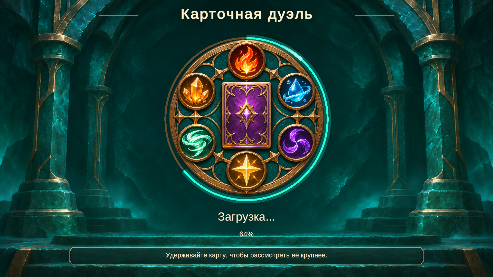

# Экран загрузки — круг стихий

Показ временно отключён: сцены загружаются слишком быстро, и экран мелькал. В LoadingScreen.asset флаг **Show On Transitions** выключен. Для возврата оформления достаточно включить его; графика, префаб и анимация сохранены. При выключенном флаге переходы остаются асинхронными, но без экрана, ожидания его показа и затухания.

Реализован вариант 1 из [концептов](loading-design-options.md). Бирюзовый каменный зал, печать шести стихий с картой в центре, светящаяся дуга прогресса, процент и сменяемые подсказки. Все надписи — живой TMP-текст из UiTexts; в изображениях нет текста или фиксированного процента.



Снимок сделан в Play mode при тестовом значении 64% для проверки оформления. В обычной игре значение поступает от загрузчика.

## Подключение

- Bootstrap → главное меню, меню → матч и матч → меню используют SceneNavigator с LoadSceneAsync.
- LoadingScreen.prefab создаётся один раз дочерним объектом постоянного AppRoot. Canvas поверх сцены сохраняется при её замене. Новых камер и AudioListener экран не создаёт.
- Экран включается до начала загрузки, блокирует нажатия на содержимое под ним и снимает выделение старой UI-кнопки. После активации новой сцены и вызова Start у её корневых объектов он плавно исчезает. Затем блокировка ввода отключается.
- Процент отражает AsyncOperation.progress: загрузка до 90%, затем активация и 100%. На небольших сценах промежуточные значения могут перескакиваться. Искусственного минимального времени показа нет; исчезновение занимает 0,2 с.
- Световой блик, дыхание печати, подсказки и исчезновение используют unscaled time. Повторный запрос во время текущего перехода не создаёт второй загрузчик.
- AnimationQueue.Stop освобождает ресурсы активного шага без завершения анимации: TweenStep, DelayStep и OpponentHighlightStep реализуют IDisposable. Это останавливает корневую DOTween-последовательность перед удалением карт и предотвращает обращения к уничтоженным Transform при выходе во время раздачи.

## Файлы и настройка

Графика:

- Assets/Art/UI/Loading/elemental-background-v1.png — фон без элементов интерфейса.
- Assets/Art/UI/Loading/elemental-seal-v1.png — печать с прозрачностью вокруг силуэта.

Оба изображения подготовлены встроенным imagegen из утверждённого макета. Импорт: Sprite, без mipmaps, максимум 2048, сжатие CompressedHQ; у печати сохранён alpha-канал.

Assets/Data/Config/LoadingScreen.asset хранит графику, стиль рамки подсказки, цвет дуги, скорость блика, дыхание печати, длительность исчезновения, ключи и интервал подсказок. Размещение и размеры текста доступны в Assets/Prefabs/LoadingScreen.prefab. Bootstrap содержит ссылки на настройки и префаб. Русские строки добавлены в UiTexts.asset.

CanvasScaler использует 1920×1080; SafeAreaFitter ограничивает содержимое безопасной зоной. Отдельный AspectRatioFitter сохраняет круг круглым, а фон заполняет экран с обрезкой архитектуры по краям. Дуга рисуется небольшой UI-сеткой без отдельного материала, тяжёлых эффектов или новых пакетов.

## Проверка

268/268 EditMode-тестов прошли через Unity MCP. Play mode: старт через Bootstrap, вход в hot-seat и в матч через обычный поиск ИИ, возврат в меню, монотонный прогресс 0 → 0,9 → 1, повторный запрос во время перехода, блокировка и освобождение ввода, единственный постоянный overlay и один активный AudioListener. Загрузка и исчезновение дополнительно проверены при Time.timeScale = 0. Остановка очереди проверена с настоящей DOTween-последовательностью: tween освобождается без вызова завершения и следующих действий. Повторный выход в меню во время раздачи не оставляет обращений к уничтоженным Transform. Визуально проверены 1920×1080, 1280×720 и 2100×900: печать не растягивается, надписи не обрезаются, фон заполняет экран.

После проверки консоль без ошибок и предупреждений, Play mode остановлен, временные разрешения и диагностические ключи удалены, настройки Game View и runInBackground восстановлены. Пользовательская коллекция не изменялась.

Проверить вручную:

1. Открыть Bootstrap и включить Play: перед меню появляется круг стихий.
2. Начать игру против ИИ или hot-seat: экран закрывает переход в Match, затем полностью исчезает.
3. Вернуться в меню после партии: переход оформлен так же, кнопки меню снова доступны.

## Промпты графики

Инструмент: встроенный imagegen, без CLI/API fallback. Исходник: docs/art-references/loading-circle-v1.png.

### Фон

```text
Edit the provided approved fantasy card game loading screen into a production BACKGROUND PLATE. Preserve exactly its painterly deep teal mineral-stone architecture, bronze edges, symmetrical arches, side columns, stairs and soft turquoise ambient illumination. Remove the ENTIRE central circular seal and all six element medallions, central card, turquoise progress arc, sparks around the seal. Remove ALL text (title, loading label, percentage, hint) and remove the bottom UI hint plaque and thin text divider decorations. Seamlessly reconstruct the removed regions as a dark quiet teal stone wall with subtle depth and the existing stone steps below. The broad middle 65% of the image must be calm dark negative space so a separate circular seal and UI text can be placed over it at runtime. Keep interesting architectural detail at the far sides, no columns crossing the empty center. No letters, no symbols, no icons, no central pedestal props, no magic progress ring, no leaves or vines. Wide landscape 16:9, high quality game background, no transparency.
```

### Печать

```text
Extract and redraw ONLY the approved CENTRAL CIRCULAR SEAL from the provided loading screen as a clean standalone game UI sprite on a fully TRANSPARENT background. Square canvas, front view, perfectly circular symmetrical seal, circle occupies 88% of canvas diameter, centered with equal transparent padding. Preserve the exact design language: dark teal stone disc with rich bronze rings and fine geometric metal inlays; six clearly separate round sculpted medallions on its rim: top orange fire, upper right blue water droplet with orbiting ribbon, lower right purple three-bladed darkness vortex, bottom gold four-point light star, lower left mint wind vortex, upper left amber crystal earth cluster. Keep the large upright purple-backed bronze-framed card in the center with its diamond emblem. Remove EVERYTHING outside the circle: architecture, floor, text, bottom plaque, sparks and ALL exterior turquoise progress arcs. NO text or numerals anywhere. No exterior cyan ring, because it will be drawn live by the game. The seal itself is opaque. Preserve painted material detail, readable forms, warm bronze edge highlights and subtle jewel illumination. No leaves or floral engravings. Genuine alpha transparency outside the silhouette, no checkerboard, no opaque background, no big ground shadow, no extra detached objects.
```
