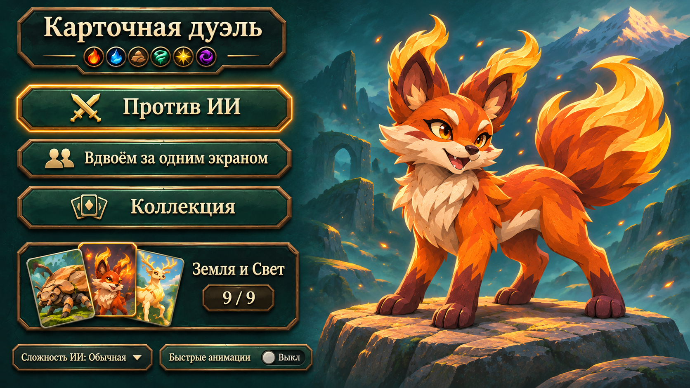
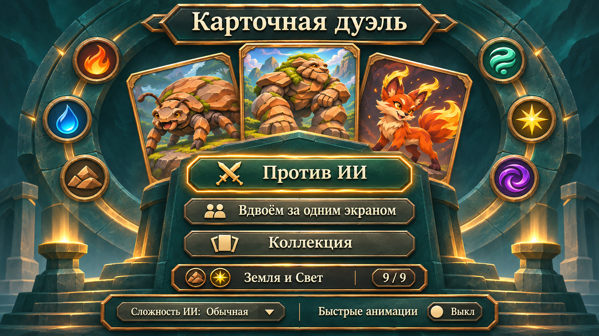
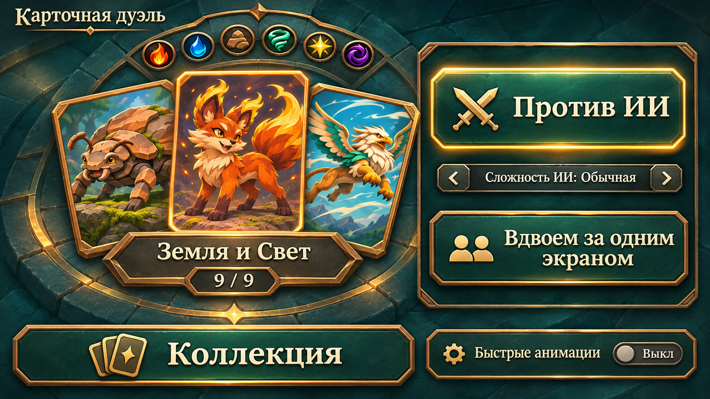

# Концепты главного меню

Три растровых концепта для выбора направления. Общая стилистика продолжает утверждённую коллекцию: бирюзовый камень, бронзовые рамки, светлый текст и существующие арты существ. Декоративной листвы нет. Рабочее название «Карточная дуэль» взято из текущего UiTexts.

Во всех вариантах сохранены текущие действия: игра против ИИ, вдвоём за одним экраном, коллекция и редактирование колод, выбранная колода, сложность ИИ и переключатель быстрых анимаций. Отображение «Земля и Свет · 9 / 9» — пример состояния выбранной колоды. Макеты пока не внедрены в сцену Unity.

| Вариант | Композиция | Сильная сторона |
|---|---|---|
| 1. Витрина | Меню слева, крупный Искровой лис справа, выбранная колода под кнопками | Выразительный первый экран и понятная навигация |
| 2. Алтарь стихий | Симметричный фон, веер карт и центральная колонка действий | Компактное меню с акцентом на карточную игру |
| 3. Стол дуэлянта | Выбранная колода слева, запуск и сложность справа, коллекция снизу | Состав колоды и настройка следующей партии видны сразу |

## 1. Витрина

## 2. Алтарь стихий

## 3. Стол дуэлянта

Все изображения созданы встроенным image_gen; полные запросы и референсы сохранены в [prompts.json](mockups/main-menu-v1/prompts.json). Это изображения для сравнения композиций: текст, кнопки и состояния при реализации должны быть отдельными элементами интерфейса. Декорации и переосмысленные иллюстрации на макетах не заменяют игровые данные и готовые лица карт.
