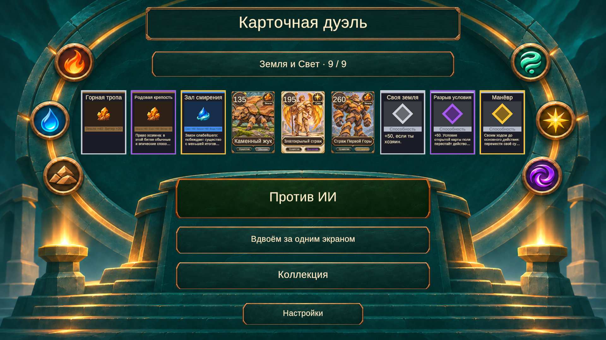
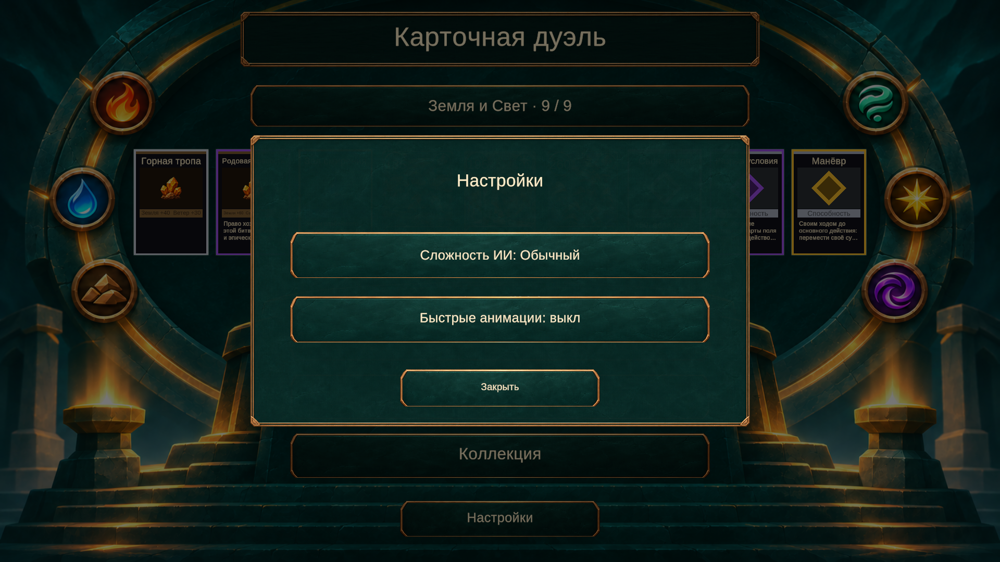

# Главное меню: Алтарь стихий

Реализовано выбранное направление [макета](mockups/main-menu-v2/02-elemental-altar-nine-cards.png). Фон храма и шести стихий — отдельная иллюстрация без текста и карточек. Заголовок, кнопки, выбранная колода, девять карт и модальные окна создаются в uGUI и используют UiTexts / игровые данные.

- Название и все карты берутся из PlayerCollection.Selected. Порядок: поля, существа, способности; внутри типа — редкость. Нажатие на карту открывает её лицо и полное описание. Нажатие на название колоды открывает коллекцию.
- Незанятые слоты показываются как «+» и открывают редактор. Попытка играть с недопустимым составом также открывает редактор по существующей логике.
- «Против ИИ», «Вдвоём за одним экраном» и «Коллекция» подключены к прежним действиям MainMenuRoot. Поддержка выбранных сохранённых пресетов и проверки DeckValidator сохранены.
- «Настройки» открывает модальное окно со сложностью ИИ и быстрыми анимациями. Из выбора сложности пользователь возвращается в настройки. Переключатель скорости сразу обновляет подпись, окно остаётся открытым. Подложка блокирует нажатия в меню за окном.
- Основное меню наследует SafeArea существующего Canvas. Фон заполняет экран с сохранением пропорций и кадрированием. Старые элементы сцены отключаются при инициализации, ссылки на живые кнопки заменяются новым представлением; сценовые сервисы и движок не меняются.

## Ресурсы

Фон: Assets/Art/UI/MainMenu/altar-background-v1.png. Получен встроенным image_gen; [полный запрос](art-prompts/main-menu-altar-background-v1.json). Ссылка на фон находится в Assets/Data/Config/MainMenu.asset (MainMenuSettings), стиль контролов переиспользует Collection.asset. Карты используют существующие лица CollectionCardView / CreatureCardFaceView, включая прежние заглушки полей и способностей. Их концептуальные арты из макета этим изменением не создавались. Подписи остаются текущим шрифтом GameFont SDF с кириллицей.

## Проверка

265/265 EditMode-тестов пройдены через MCP. В Play mode на временной коллекции в памяти проверены: девять настоящих ID выбранной колоды, смена пресета и обновление превью, открытие/закрытие настроек, переключение быстрых анимаций с восстановлением исходного значения, выбор сложности и возврат, просмотр карты, переход в коллекцию и обратно, выбор второй колоды для hot-seat, пустая колода и её перенаправление в редактор. Матч против ИИ запущен из нового меню; все девять ID в MatchLaunch совпали с выбранным составом, ИИ подключён. Сохранённые колоды пользователя не изменялись.

Визуально проверены 1920×1080, 1280×720, 2100×900. Временные размеры Game View удалены, исходное разрешение восстановлено. Консоль без ошибок и предупреждений, Play mode остановлен.

Проверка вручную: Bootstrap → меню; открыть карту, настройки и сложность; сменить выбранный пресет через коллекцию; вернуться и проверить состав; запустить ИИ и игру вдвоём.
