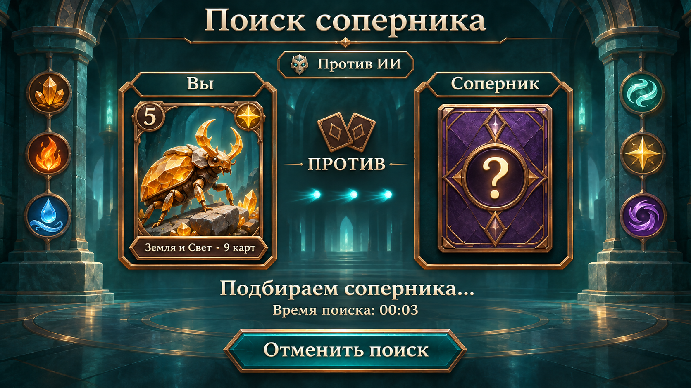
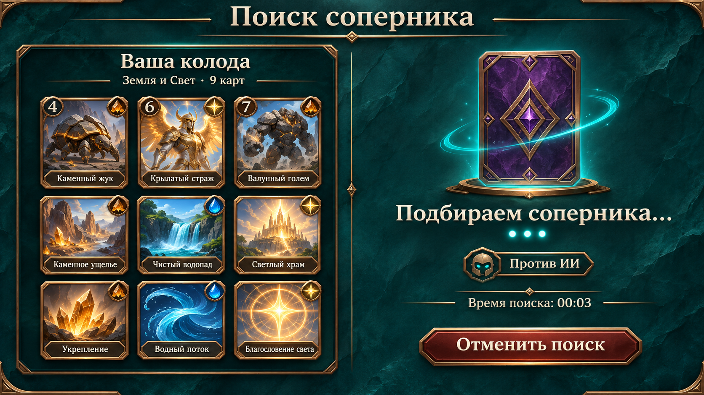
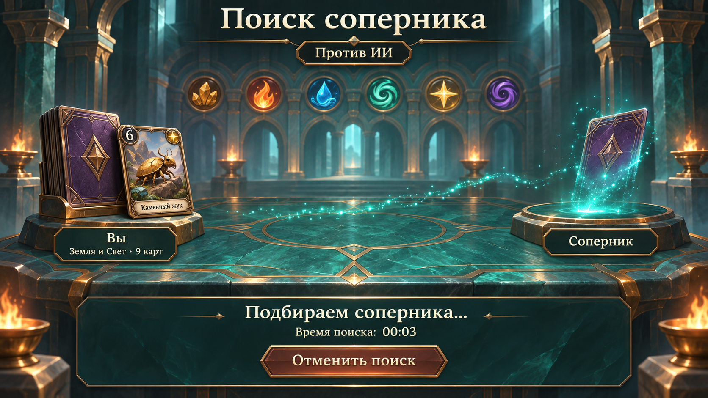

# Макеты поиска соперника

Три статических концепта, созданных встроенным imagegen, для выбора перед реализацией. Бирюзовый камень, бронзовые рамки, кремовый текст, символы стихий; без листвы. В текущей игре поиск обслуживает локальный MatchmakingService и подбирает ИИ; макеты не подразумевают уже реализованную сетевую игру.

Во всех вариантах есть статус поиска, прошедшее время и кнопка отмены. Проценты и полосы загрузки отсутствуют. Значение 00:03 служит примером таймера. При реализации карты, их названия, сила, стихии и изображения будут взяты из данных проекта, а состав колоды — из выбранного пресета. Иллюстрации и числа на концептах демонстрируют компоновку и не меняют каталог карт.

## 1. Дуэльные панели



## 2. Колода и поиск



## 3. Стол ожидания



## Сравнение

| Вариант | Основная идея | Что можно анимировать |
|---|---|---|
| 1. Дуэльные панели | Игрок и неизвестный соперник напротив друг друга | Световые импульсы между панелями, появление соперника |
| 2. Колода и поиск | Все девять карт выбранной колоды слева, поиск справа | Свечение рубашки, три точки ожидания |
| 3. Стол ожидания | Атмосферная сцена с двумя местами за столом | Частицы, проявление карты соперника |

Отмена должна продолжить использовать существующий CancelSearch, поиск — существующий IMatchmakingService. Искусственно продлевать поиск ради анимации не требуется. Экран загрузки временно отключён отдельно; его можно вернуть флагом Show On Transitions в LoadingScreen.asset.

## Промпты

Инструмент: встроенный imagegen, без CLI/API fallback.

### 1. Дуэльные панели

```text
Use case: ui-mockup. Create ONE premium full-screen OPPONENT SEARCH interface concept for a Russian fantasy collectible card duel game, landscape 16:9, composed as an actual crisp 1920x1080 game UI screenshot, no surrounding device and no multi-screen collage. Established identity: deep teal mineral stone, warm bronze thin chamfered frames, ivory lettering, colorful jewel-like elemental emblems, polished painterly fantasy illustration. Purple card backs with bronze diamond motifs; creature cards have bronze frames, a circular power badge upper left, elemental jewel upper right and title plaque below. Six elements: amber crystals earth, orange flame fire, blue droplet and ribbon water, mint whirlwind wind, gold four-point star light, purple vortex darkness. No leaves, vines or floral ornament. Strong hierarchy, calm negative space, safe margins, large readable Cyrillic text. This is SEARCHING FOR AN OPPONENT, distinct from loading: NO progress bar, NO percentages, NO loading text, NO reward buttons. Always show a clear cancel button. Current mode is against AI: display small badge "Против ИИ". Do not invent online player counts, ranks, rating, network latency, player usernames or a found opponent identity. Correctly spell all Russian copy. No logos of other games.
Concept 1 — DUEL PANELS. Symmetric, very legible front-facing composition. Top heading "Поиск соперника". Two large bronze-trimmed portrait panels face each other across the middle: left panel "Вы", showing a handsome golden stone beetle creature portrait on teal, with a small bronze deck plaque below reading "Земля и Свет · 9 карт"; right panel "Соперник", showing an elegantly ornate violet card back and a glowing question-mark medallion, clearly unknown. Between the panels place two small crossing card-shaped bronze emblems and the word "ПРОТИВ", with three turquoise light motes moving from left to right as the static frame of a search animation. The background is a softly shadowed teal ancient stone hall with restrained elemental medallions far to the sides. Below the duel panels, center the status "Подбираем соперника..." and the timer "Время поиска: 00:03". At bottom center one wide chamfered teal and bronze button "Отменить поиск". Keep panels inside central 65% width, no busy secondary panels, no tip strip. Professional balanced spacing, rich materials but minimal distractions. Do not write a concept number in the image.
```

### 2. Колода и поиск

```text
Use case: ui-mockup. Create ONE premium full-screen OPPONENT SEARCH interface concept for a Russian fantasy collectible card duel game, landscape 16:9, composed as an actual crisp 1920x1080 game UI screenshot, no surrounding device and no multi-screen collage. Established identity: deep teal mineral stone, warm bronze thin chamfered frames, ivory lettering, colorful jewel-like elemental emblems, polished painterly fantasy illustration. Purple card backs with bronze diamond motifs; creature cards have bronze frames, a circular power badge upper left, elemental jewel upper right and title plaque below. Six elements: amber crystals earth, orange flame fire, blue droplet and ribbon water, mint whirlwind wind, gold four-point star light, purple vortex darkness. No leaves, vines or floral ornament. Strong hierarchy, calm negative space, safe margins, large readable Cyrillic text. This is SEARCHING FOR AN OPPONENT, distinct from loading: NO progress bar, NO percentages, NO loading text, NO reward buttons. Always show a clear cancel button. Current mode is against AI: display small badge "Против ИИ". Do not invent online player counts, ranks, rating, network latency, player usernames or a found opponent identity. Correctly spell all Russian copy. No logos of other games.
Concept 2 — DECK AND SEARCH, an asymmetric library/editor composition. Top heading "Поиск соперника". Left 48% of screen contains a handsome dark teal inset library panel titled "Ваша колода", a small line "Земля и Свет · 9 карт", and EXACTLY NINE miniature portrait trading cards in a clean 3 by 3 grid, not a random fan. Show a mixture of three illustrated creatures (stone beetle, golden winged guardian, boulder golem), three field cards with earth/water/light landscape motifs, and three ability cards with restrained magical emblems. Cards should clearly look like real trading cards with bronze frames and tiny title bars; avoid dense illegible fine print. Right 42% is a quiet search area with a tall ornate violet unknown opponent card hovering above a small bronze base, a subtle turquoise scanning sweep around its edges, and below the card the large status "Подбираем соперника..." with three separate luminous dots. A small badge reads "Против ИИ", the timer line reads "Время поиска: 00:03". Bottom right a wide clear button "Отменить поиск". Thin bronze separators, teal stone background, excellent contrast and clean hierarchy. The deck panel is secondary to the active search state but invites inspecting the selected deck while waiting. No big VS letters, no loading ring or progress indicator. Do not write a concept number in the image.
```

### 3. Стол ожидания

```text
Use case: ui-mockup. Create ONE premium full-screen OPPONENT SEARCH interface concept for a Russian fantasy collectible card duel game, landscape 16:9, composed as an actual crisp 1920x1080 game UI screenshot, no surrounding device and no multi-screen collage. Established identity: deep teal mineral stone, warm bronze thin chamfered frames, ivory lettering, colorful jewel-like elemental emblems, polished painterly fantasy illustration. Purple card backs with bronze diamond motifs; creature cards have bronze frames, a circular power badge upper left, elemental jewel upper right and title plaque below. Six elements: amber crystals earth, orange flame fire, blue droplet and ribbon water, mint whirlwind wind, gold four-point star light, purple vortex darkness. No leaves, vines or floral ornament. Strong hierarchy, calm negative space, safe margins, large readable Cyrillic text. This is SEARCHING FOR AN OPPONENT, distinct from loading: NO progress bar, NO percentages, NO loading text, NO reward buttons. Always show a clear cancel button. Current mode is against AI: display small badge "Против ИИ". Do not invent online player counts, ranks, rating, network latency, player usernames or a found opponent identity. Correctly spell all Russian copy. No logos of other games.
Concept 3 — THE WAITING TABLE, a cinematic environment with minimal overlay UI, visually distinct from a symmetric dashboard or a library grid. A richly painted ancient teal stone duel table viewed at a shallow three-quarter angle in a grand temple hall, bronze inlaid channels and small warm braziers, no foliage. At the left seat is the player's upright bronze-framed deck case and a single ornate card with a golden stone beetle emblem, at the opposite right seat is an empty counterpart pedestal above which one unknown purple-backed card is only half materializing from turquoise sparks. A subtle stream of small turquoise light particles crosses the table between the two seats as an opponent-search animation frame, not a progress bar. The distant architecture bears six colorful small element medallions. At upper center place the refined clear heading "Поиск соперника", below it a small dark bronze-edged badge "Против ИИ". Near the left seat add a compact plaque "Вы" and below it "Земля и Свет · 9 карт"; near the right empty seat a plaque "Соперник". Keep the scene broad, atmospheric and readable, do not bury UI in glowing effects. At the bottom, a calm low-height translucent dark teal bronze-edged interface panel holds centered status "Подбираем соперника...", timer "Время поиска: 00:03", and one prominent centered button "Отменить поиск". No percent indicator, no complete progress track, no gameplay score HUD, no fake player portraits. Do not write a concept number in the image.
```
