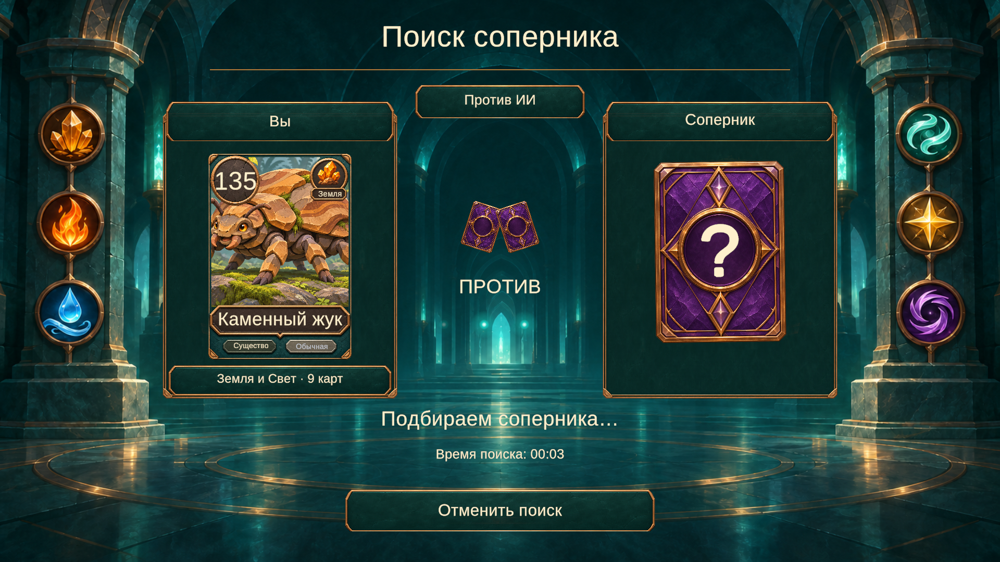

# Поиск соперника — дуэльные панели

Реализован вариант 1 из [макетов](search-design-options.md): игрок и неизвестный соперник друг напротив друга, движущиеся световые импульсы между ними, время поиска и кнопка отмены.



Снимок сделан в Play mode при визуальной проверке с тестовым временем 00:03. В обычной игре время считается от фактического запуска поиска; длительность MatchmakingConfig не увеличивалась.

## Поведение

- Слева показано существо минимальной редкости из выбранного пресета. Арт, рамка, название, сила, стихия, тип и редкость отображаются общим CreatureCardFaceView, как в коллекции и на столе. Название пресета и число карт берутся из PlayerCollection.Selected. При следующем поиске данные обновляются, без привязки к конкретному ID карты.
- Справа остаётся неизвестная карта с живым знаком вопроса. Подбор пока локальный, против ИИ; экран явно показывает этот режим, не выводит вымышленные рейтинги и онлайн-статистику.
- Время поиска и анимация используют unscaled time. Таймер сбрасывается при каждом Show, обновляется только при смене секунды. Три световых импульса рисуются небольшой UI-сеткой; карта соперника слегка покачивается.
- Отмена вызывает прежний CancelSearch и IMatchmakingService.Cancel, скрывает поиск и возвращает меню. Повторное открытие не накапливает обработчики кнопки. Когда соперник подобран, прежний OnMatchFound передаёт сессию и выбранную колоду в Match.
- Экран загрузки остаётся отключённым. Поиск не добавляет искусственной задержки перед партией.

## Настройки и ресурсы

Assets/Data/Config/Searching.asset содержит фон, рубашку неизвестного соперника, цвет и период импульсов, амплитуду, период и наклон карты. Ссылка на ассет записана в MainMenu.unity. SearchingLayout использует существующий CollectionUi для бронзовых рамок и кнопок; русские надписи и формат таймера собраны в UiTexts.asset.

Декоративный фон расположен отдельно от SafeArea. Панели и карточные портреты используют AspectRatioFitter, поэтому сохраняют пропорции от 16:9 до 21:9. Текст создаётся под активным родителем: это даёт TMP выполнить Awake до настройки авторазмера и предотвращает потерю мелких подписей на карте. У новых подписей поиска используется Truncate без требования отсутствующего в шрифте символа многоточия для режима Ellipsis.

Графика подготовлена встроенным imagegen из утверждённого макета:

- Assets/Art/UI/Search/duel-background-v1.png — зал с шестью декоративными медальонами, без текста и панелей.
- Assets/Art/UI/Search/unknown-card-v1.png — рубашка с прозрачностью, пустой центральный медальон; знак вопроса рисует TMP.

Импорт через Unity AssetDatabase: Sprite, без mipmaps, максимум 2048, CompressedHQ. Новых пакетов или постобработки нет. Правила и каталог карт не менялись.

## Проверка

268/268 EditMode-тестов прошли через Unity MCP. Консоль без ошибок и предупреждений. После проверки Play mode остановлен, временные разрешения Game View удалены, runInBackground и исходный размер окна восстановлены, диагностические ключи удалены. Пользовательская коллекция не редактировалась: проверки выполнялись с временным хранилищем в памяти.

Play mode через Unity MCP: 1920×1080, 1280×720 и 2100×900; читаемость всех подписей, отсутствие переполнения, пропорции карты, видимость импульсов, попадание UI-raycast на кнопку отмены. Проверены две реальные отмены подряд, возврат меню и отсутствие запоздалого перехода в матч после отмены; новый поиск сбрасывает таймер. Выбор другого пресета обновляет существо и его настоящую силу. Реальный поиск успешно приводит в матч с ИИ с выбранной колодой; отключённый экран загрузки не появляется. Таймер продолжает идти при Time.timeScale = 0.

Проверить вручную:

1. Bootstrap → Play → «Против ИИ»: проверить выбранную колоду, время и анимацию поиска.
2. Нажать «Отменить поиск», убедиться, что меню доступно и партия не начинается позже.
3. Выбрать другой пресет и повторить поиск: карта и название должны обновиться; дождаться перехода в матч.

## Промпты графики

Встроенный imagegen, без CLI/API fallback. Исходник: docs/art-references/search-duel-v1.png.

### Фон

```text
Edit the provided approved opponent-search screen into a production BACKGROUND PLATE for that exact UI. Preserve its deep teal stone hall, symmetrical tall side columns, distant doorway, arched architecture, beautiful bronze inlays on the floor, ambient turquoise light and warm bronze edges. Preserve the six decorative elemental medallions on the FAR SIDE columns: earth crystals, fire, water on the left; wind, light, darkness on the right. Remove ALL interface content from the middle: title text and its underline, AI mode plaque and robot icon, both big player panels and their frames, both cards, all player/deck labels, crossed card symbol, word ПРОТИВ, three glowing motes, status text, timer, cancel button and any lettering or numerals. Seamlessly reconstruct those areas as quiet dark atmospheric teal architecture and floor. Keep central 65% width calm for dynamic card panels and text. No new objects, no foliage, no letters, no UI frames, no central pedestal, no glowing progress ring, no silhouettes of removed panels. Landscape 16:9, polished painterly fantasy game environment. Opaque image.
```

### Рубашка

```text
Extract and recreate ONLY the right-hand UNKNOWN OPPONENT CARD from the provided approved concept as a standalone production UI sprite on a genuinely TRANSPARENT background. Portrait card silhouette, straight front view, centered, 5% transparent margin, approximately 0.70 width to height. Preserve richly painted purple cracked crystal/card-back surface, sophisticated bronze angular chamfered frame, small decorative diamond at top and bottom, and the large bronze circular medallion in the middle. REMOVE the question mark from the medallion and leave its center clean dark purple so a live question mark can be drawn there in the game. The circle must be centered exactly at 50% width and 50% height, diameter around 68% of card width. No text, numerals, question marks or other letters anywhere. No outer player panel, no opponent label, no floor, architecture, particles or drop shadow outside the silhouette. Subtle highlights inside the opaque bronze frame only; truly transparent pixels around the card, no checkerboard or opaque background. Match the approved bronze and purple materials closely.
```
