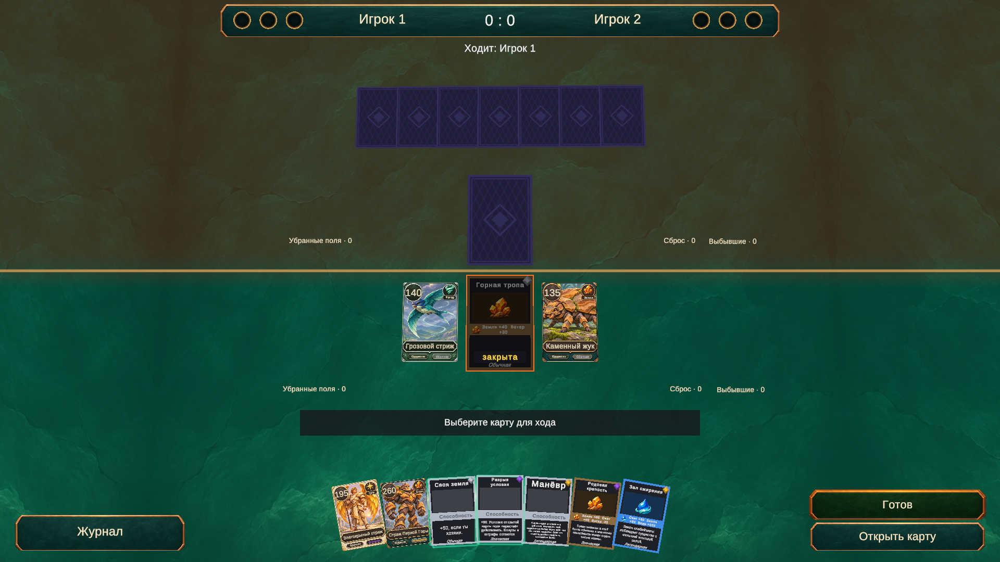

# Поле битвы на весь экран

Чёрные полосы появлялись за краями поверхности фиксированного размера 20 × 18. Камера уже занимала весь экран, но самого стола не хватало на её обзор.

`TableSurfaceFitter` на `TableEnvironment` расширяет поверхность и цветовое разделение сторон до углов обзора камеры. Пересчёт выполняется после `CameraFramer`, при изменении камеры или разрешения. Дополнительный запас задаётся полем `Table Screen Padding` в `Assets/Data/Config/TablePresentation.asset` (0,75 мировой единицы).

Масштабирование затрагивает только поверхность и её цветовую накладку по X/Z. Высота, камера, карты, зоны ввода и HUD сохраняются. Поверхности не используют static batching; четыре бортика выключены, чтобы не образовывать границу внутри экрана. Коллайдеры не добавляются.

Текстура сохраняет плотность и положение относительно мира через MaterialPropertyBlock. У фоновой текстуры включён Mirror: продолжение за исходными краями не растягивается. В коллекции её UV остаются в диапазоне 0–1. Толщина центральной разделительной линии компенсирует увеличение поверхности.

## Проверка

Через Unity MCP в одной Play-сессии проверены 1920×1080, 1280×720, 2100×900, 3200×900, 1200×900 и 900×1600. Лучи в углах и серединах краёв экрана попадают внутрь обеих поверхностей. Отдельно проверено, что изменение запаса поверхности не меняет камеру и положение или масштаб 18 карт. Проверка вертикального окна относится к покрытию фона; целевой интерфейс проекта остаётся горизонтальным.

268 EditMode-тестов пройдены. Консоль без ошибок и предупреждений. Временные разрешения удалены, исходный Game View восстановлен, Play mode остановлен, открыта Bootstrap. Пользовательская коллекция не изменялась.

Проверить вручную: запустить партию из Bootstrap и менять размер окна между 16:9, 21:9 и 4:3. Каменный фон и разделение сторон должны доходить до всех краёв; карты и кнопки должны оставаться доступными.
