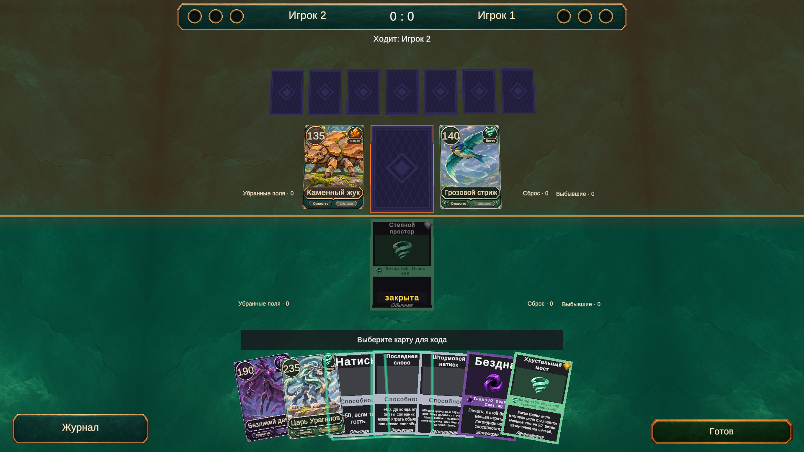
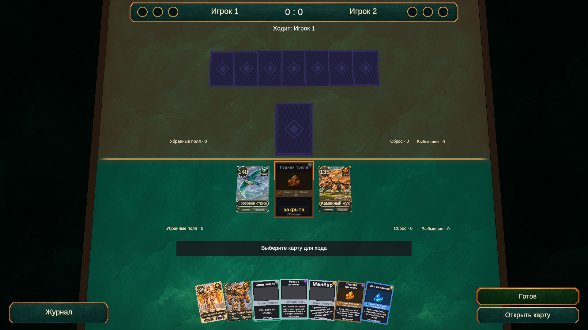

# Интерфейс партии без боковой панели

Актуальная версия [варианта 2](battle-design-options.md). Стол занимает всю ширину экрана. Сохранены [анимированная подсветка карт, дуга руки и разделение сторон](card-feedback.md).

Поверхность стола [адаптируется к разрешению и соотношению сторон](table-fullscreen.md), заполняя фон без чёрных полос.

## Увеличенные карты

В TablePresentation.asset масштаб руки равен 1,5 (последнее увеличение с 1,2 — ещё на 25%). Поля и существа на столе имеют одинаковый масштаб 1,8; он сохраняется до и во время битвы. Шаг руки увеличен до 1,6; существующее сжатие веера под ширину экрана сохранено. Ряды полей раздвинуты с ±1,55 до ±1,95, рука соперника отодвинута с 4,8 до 5,2, чтобы увеличенные карты не перекрывались.

В Play mode через MCP проверены 1280×720, 1920×1080 и 2100×900: проекции руки из 1, 7 и 9 карт внутри экрана, без пересечения с кнопками журнала и действий. Поля и слоты существ не пересекаются. Проверены журнал, счёт и доступность существ для ввода; консоль без ошибок и предупреждений. Изменены только настройки и сцена, скрипты и правила не менялись. После проверки восстановлены Game View, Bootstrap и runInBackground; пользовательская коллекция не изменялась.

Проверить вручную: запустить партию против ИИ, выбрать и перетащить карту из полной руки, открыть её крупно, выставить существ и начать битву. Оценить размер текста и удобство выбора карт при своём разрешении.

## Раскладка карт

У каждого поля постоянный ряд: карта поля по центру, существо текущего зрителя справа, существо соперника слева. Таким образом, со стороны каждого владельца его существо стоит справа от поля. Место не зависит от того, кто первым выставил существо. Карты не перекрываются; при смене зрителя в hot-seat расположение существ зеркально меняется за экраном передачи хода.

TableSync использует одну раскладку до начала битвы и во время неё. Начало битвы не переносит и не увеличивает участников, не отодвигает второе поле и существ на нём. Убрано и краткое увеличение карт в BattleStartedPresenter; остаются звук, баннер и подсветка поля. Обычное перемещение сыгранной карты из руки и последствия завершения битвы сохранены. В hot-seat стол по-прежнему меняет перспективу за непрозрачным экраном передачи хода.

Assets/Data/Config/TacticalHud.asset содержит стиль оформления, горизонтальное смещение полей, зазор между картами и расстояние до руки соперника. Сцена Match.unity ссылается на этот ассет. Старые настройки боковой панели и увеличения карт битвы удалены. Баннеры центрируются относительно всего экрана.

## Элементы интерфейса

- Сверху — компактная плашка с именами игроков, счётом и круглыми отметками побед: бирюзовыми у зрителя и янтарными у соперника. Отметки строятся как UI-геометрия, без зависимости от шрифта или встроенных спрайтов Unity. Их количество берётся из WinsToWin. Надпись «До 3 побед» не выводится; правило победы не менялось.
- Под плашкой остаётся указатель текущего игрока. Особое правило сравнения силы показывается отдельным индикатором.
- Кнопка «Журнал» находится слева снизу. По умолчанию список закрыт; нажатие раскрывает его вверх. Сохранены прокрутка, ограничение длины истории и переход к последним событиям. События продолжают поступать, когда журнал свёрнут.
- Разрешённые действия расположены справа снизу: «Готов», «Открыть поле», «Конец хода», «Отмена» и сведения о прошлой битве. Используются существующие обработчики HumanDecisionUi.
- Панели силы существ и сведений о поле справа удалены. Подсказка остаётся над рукой. Крупный просмотр карт и диалог результатов доступны как прежде.
- Счётчики сброса, выбывших существ и убранных полей остаются возле соответствующих стопок.

Изменения относятся к Presentation и настройкам Data. Движок, правила, колоды и логика ИИ не изменялись. Используются существующие графика и uGUI; новые пакеты не требуются.

## Проверка

268/268 EditMode-тестов прошли через MCP. Отдельная проверка на реальной последовательности команд движка и TableSync подтвердила: оба поля и уже выставленное существо сохраняют позицию, поворот и масштаб при появлении второго существа и начале битвы; поле расположено по центру, существо зрителя справа, а соперника слева. Это дополнительно проверено с точки зрения обоих игроков.

В Play mode проверены hot-seat и игра против ИИ: выставление существ, передача хода, нажатия «Готов» и «Открыть поле», завершение битвы. Счёт 0 : 1 и число заполненных отметок сверены с PlayerView. Проверены открытие и закрытие журнала, прокрутка длинной истории колесом, поступление событий в закрытый список и показ последней записи после открытия. Интерфейс не блокирует выбор существ на столе.

Визуальная проверка: 1920×1080, 1280×720 и 2100×900. Кнопки остаются справа снизу и не перекрываются рукой. Консоль без ошибок и предупреждений. Временные разрешения удалены, Game View и runInBackground восстановлены, Play mode остановлен. Пользовательская коллекция не редактировалась.

Проверить вручную:

1. Bootstrap → игра против ИИ: выставить существо на любое поле, начать битву вторым существом; убедиться, что соседнее поле и его существо стоят на месте.
2. Открыть и свернуть журнал, прокрутить историю.
3. Нажать «Открыть поле» на разрешённом ходу, затем «Готов»; после битвы проверить счёт и отметку победы.
4. Повторить в hot-seat и убедиться, что передача хода сохраняет скрытую руку соперника.
